# Step 0: Full Project Analysis

This document presents a comprehensive, code-verified architectural analysis of the **Zomato Reel Feed** system. Every claim, route, and function referenced corresponds directly to exact line numbers in the repository.

---

## 0.1 What the Project Is

### Name & Core Purpose
**Zomato Reel Feed** is a video-first culinary discovery platform. Traditional food delivery and restaurant portals rely heavily on static photography, text-heavy menus, and star ratings. These formats fail to communicate the sizzle, texture, preparation artistry, and real portion size of fresh dishes. Zomato Reel Feed transforms the discovery phase into an engaging, vertical short-form video feed (reminiscent of Instagram Reels and TikTok), connecting local restaurants (**Food Partners**) directly with hungry consumers (**Users**).

### Target Users & Personas
1. **The Consumer (Foodie / Normal User):**
   - Seeks visual culinary inspiration rather than searching for a specific restaurant by name.
   - Scrolls through a fluid, auto-playing video stream of prepared dishes.
   - Likes dishes to show appreciation and bookmarks ("saves") videos to revisit when ordering or dining out.
   - Clicks through from a mouth-watering reel to inspect the creator restaurant's profile, address, and full menu catalog.
2. **The Food Partner (Restaurant / Cloud Kitchen Owner):**
   - Struggles with customer acquisition costs and low visibility on crowded static menu lists.
   - Directly uploads short culinary videos (MP4/WebM) demonstrating dish preparation and plating.
   - Receives a dedicated merchant profile showcasing their business address, metrics (meals prepared, customers served), and full video gallery.

### Main User Journeys

#### Journey 1: Consumer Food Discovery & Interaction
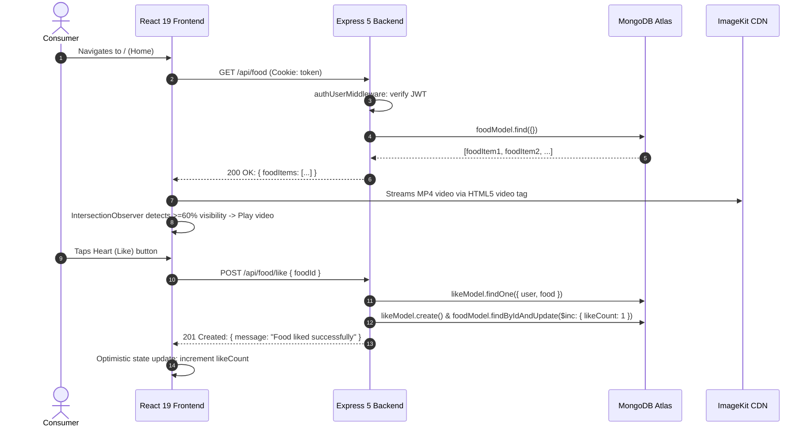

#### Journey 2: Food Partner Onboarding & Video Publishing
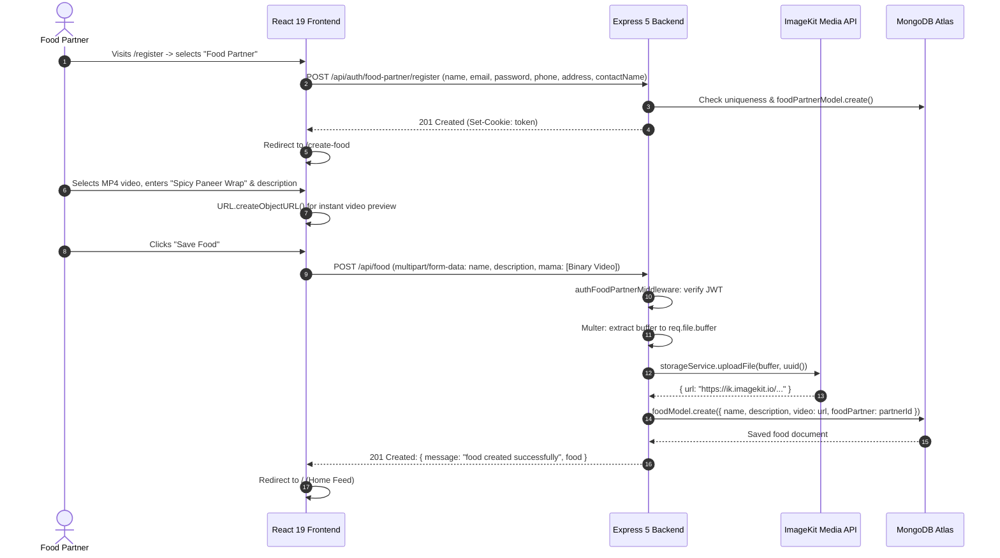

### Every Page and Screen in Frontend

| Route | Page Component | Access | Allowed User Actions | File Reference |
|---|---|---|---|---|
| `/` | `Home.jsx` | Authenticated Consumer | Watch auto-playing vertical food reels, tap like/unlike, tap bookmark/unbookmark, navigate to Food Partner profile page via "Visit store" link. | [`zomato/frontend/src/pages/general/Home.jsx`](file:///Users/avishjain/avishjain9-repos/55-zomato-reel-feed/zomato/frontend/src/pages/general/Home.jsx) |
| `/saved` | `Saved.jsx` | Authenticated Consumer | View personal bookmarked food reels, remove items from bookmarks, watch bookmarked video playback. | [`zomato/frontend/src/pages/general/Saved.jsx`](file:///Users/avishjain/avishjain9-repos/55-zomato-reel-feed/zomato/frontend/src/pages/general/Saved.jsx) |
| `/register` | `ChooseRegister.jsx` | Public | Choose between Consumer registration (`/user/register`) and Food Partner registration (`/food-partner/register`). | [`zomato/frontend/src/pages/auth/ChooseRegister.jsx`](file:///Users/avishjain/avishjain9-repos/55-zomato-reel-feed/zomato/frontend/src/pages/auth/ChooseRegister.jsx) |
| `/user/register` | `UserRegister.jsx` | Public | Register new consumer account (First Name, Last Name, Email, Password). Stores JWT cookie and redirects to `/`. | [`zomato/frontend/src/pages/auth/UserRegister.jsx`](file:///Users/avishjain/avishjain9-repos/55-zomato-reel-feed/zomato/frontend/src/pages/auth/UserRegister.jsx) |
| `/user/login` | `UserLogin.jsx` | Public | Sign in existing consumer account with Email and Password. Stores JWT cookie and redirects to `/`. | [`zomato/frontend/src/pages/auth/UserLogin.jsx`](file:///Users/avishjain/avishjain9-repos/55-zomato-reel-feed/zomato/frontend/src/pages/auth/UserLogin.jsx) |
| `/food-partner/register` | `FoodPartnerRegister.jsx` | Public | Register new merchant account (Business Name, Contact Name, Phone, Email, Password, Address). Redirects to `/create-food`. | [`zomato/frontend/src/pages/auth/FoodPartnerRegister.jsx`](file:///Users/avishjain/avishjain9-repos/55-zomato-reel-feed/zomato/frontend/src/pages/auth/FoodPartnerRegister.jsx) |
| `/food-partner/login` | `FoodPartnerLogin.jsx` | Public | Sign in existing food partner. Stores JWT cookie and redirects to `/create-food`. | [`zomato/frontend/src/pages/auth/FoodPartnerLogin.jsx`](file:///Users/avishjain/avishjain9-repos/55-zomato-reel-feed/zomato/frontend/src/pages/auth/FoodPartnerLogin.jsx) |
| `/create-food` | `CreateFood.jsx` | Authenticated Food Partner | Drag-and-drop video upload, local client video preview, enter dish name & description, publish to ImageKit CDN and MongoDB. | [`zomato/frontend/src/pages/food-partner/CreateFood.jsx`](file:///Users/avishjain/avishjain9-repos/55-zomato-reel-feed/zomato/frontend/src/pages/food-partner/CreateFood.jsx) |
| `/food-partner/:id` | `Profile.jsx` | Authenticated Consumer / Partner | View merchant profile header (avatar, business name, address, meals served pills) and 3-column video grid of all published reels. | [`zomato/frontend/src/pages/food-partner/Profile.jsx`](file:///Users/avishjain/avishjain9-repos/55-zomato-reel-feed/zomato/frontend/src/pages/food-partner/Profile.jsx) |

---

## 0.2 Every Feature, With a Full Trace (F1 – F15)

---

### F1: Consumer User Registration & JWT Cookie Session
* **User Experience:** Consumer fills first name, last name, email, and password on `/user/register` and submits form. Upon success, redirected to `/`.
* **Frontend Flow:** Form submit triggered in [`UserRegister.jsx:11-33`](file:///Users/avishjain/avishjain9-repos/55-zomato-reel-feed/zomato/frontend/src/pages/auth/UserRegister.jsx#L11-L33). Concatenates `firstName + " " + lastName` as `fullName`. Makes Axios POST request with `{ fullName, email, password }` and `withCredentials: true`. Navigates to `/` using `useNavigate()`.
* **API Call:** `POST http://localhost:3000/api/auth/user/register`
* **Backend Flow:** Routed by [`auth.routes.js:7`](file:///Users/avishjain/avishjain9-repos/55-zomato-reel-feed/zomato/backend/src/routes/auth.routes.js#L7) to `authController.registerUser` in [`auth.controller.js:6-43`](file:///Users/avishjain/avishjain9-repos/55-zomato-reel-feed/zomato/backend/src/controllers/auth.controller.js#L6-L43).
  1. Checks if email exists: `userModel.findOne({ email })`.
  2. Hashes password: `bcrypt.hash(password, 10)`.
  3. Inserts user: `userModel.create({ fullName, email, password: hashedPassword })`.
  4. Signs token: `jwt.sign({ id: user._id }, process.env.JWT_SECRET)`.
  5. Sets cookie: `res.cookie("token", token)`.
  6. Returns HTTP 201 with sanitized user payload (excluding password).
* **Database Operations:** Read query on `users` collection for `email`, followed by insert document with generated `_id`, `fullName`, `email`, `password`, and timestamps.
* **External Calls:** None.
* **Response Path:** HTTP 201 response -> Axios promise resolves -> `navigate("/")`.
* **Failure Handling:** If email exists, returns HTTP 400 `{ message: "User already exists" }`. If MongoDB is down, Express error handler traps connection error.

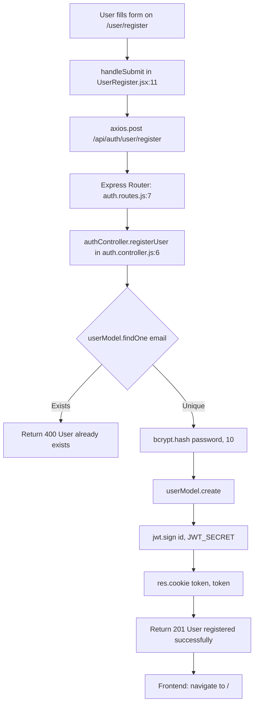

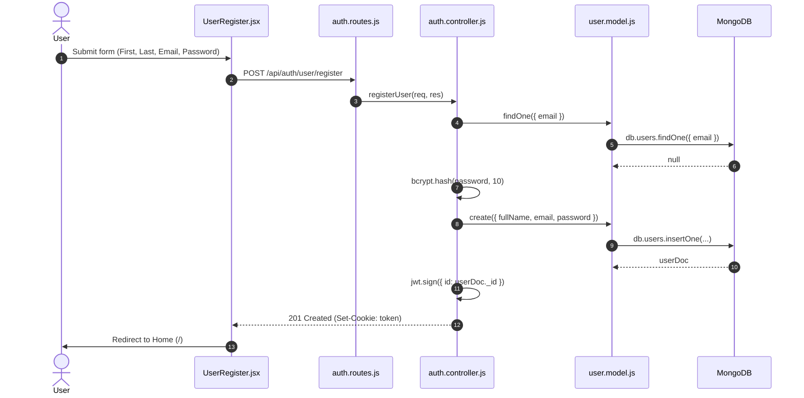

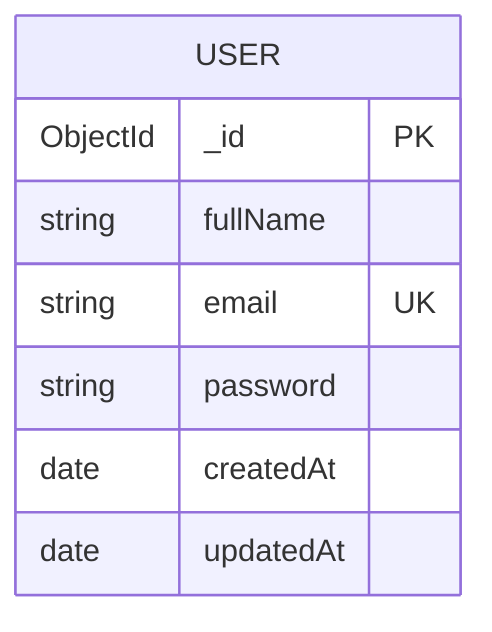

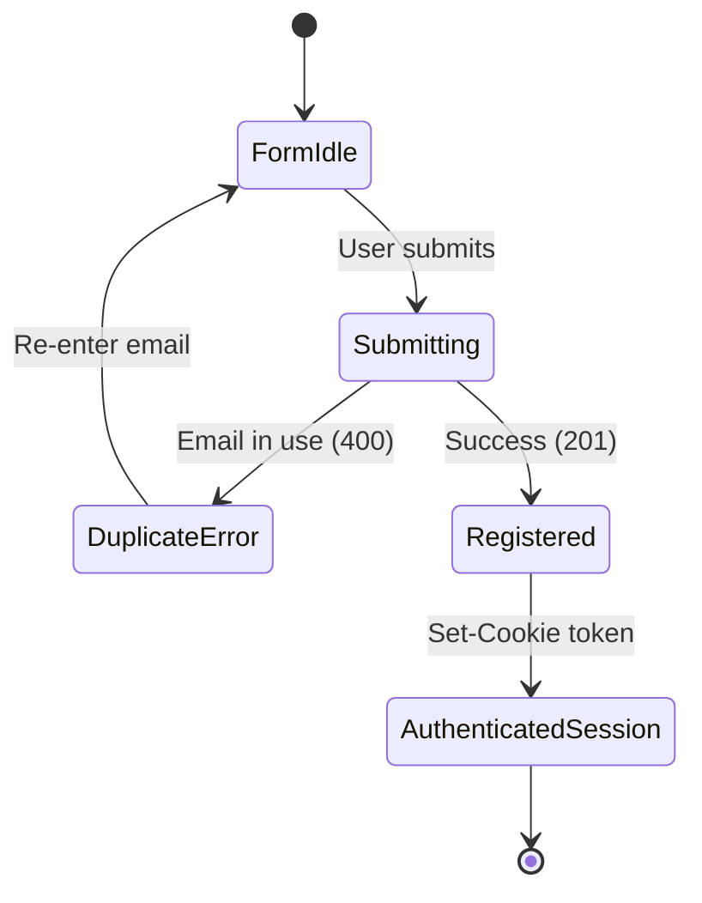

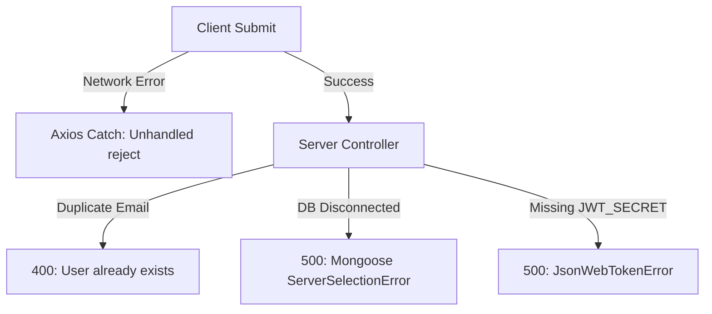

---

### F2: Consumer User Login
* **User Experience:** Consumer inputs registered email and password on `/user/login`. On validation, gets logged in and redirected to `/`.
* **Frontend Flow:** [`UserLogin.jsx:10-25`](file:///Users/avishjain/avishjain9-repos/55-zomato-reel-feed/zomato/frontend/src/pages/auth/UserLogin.jsx#L10-L25). Captures `email` and `password`. Sends Axios POST with `withCredentials: true`. Navigates to `/`.
* **API Call:** `POST http://localhost:3000/api/auth/user/login`
* **Backend Flow:** [`auth.routes.js:8`](file:///Users/avishjain/avishjain9-repos/55-zomato-reel-feed/zomato/backend/src/routes/auth.routes.js#L8) -> `authController.loginUser` ([`auth.controller.js:45-81`](file:///Users/avishjain/avishjain9-repos/55-zomato-reel-feed/zomato/backend/src/controllers/auth.controller.js#L45-L81)).
  1. Queries user by email: `userModel.findOne({ email })`.
  2. If not found, returns HTTP 400 `{ message: "Invalid email or password" }`.
  3. Verifies password hash: `bcrypt.compare(password, user.password)`.
  4. If mismatch, returns HTTP 400 `{ message: "Invalid email or password" }`.
  5. Signs JWT: `jwt.sign({ id: user._id }, process.env.JWT_SECRET)`.
  6. Sets cookie `token` and returns HTTP 200 with user profile.
* **Database Operations:** Single index-backed read query `db.users.findOne({ email })`.
* **Response Path:** HTTP 200 -> browser stores `token` cookie -> redirects to `/`.
* **Failure Handling:** Constant-message error return ("Invalid email or password") prevents user enumeration.

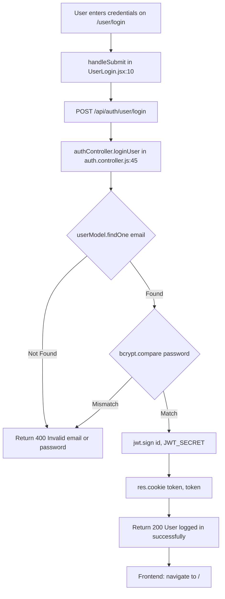

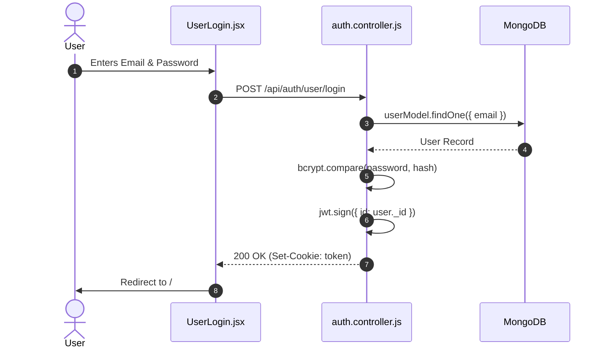

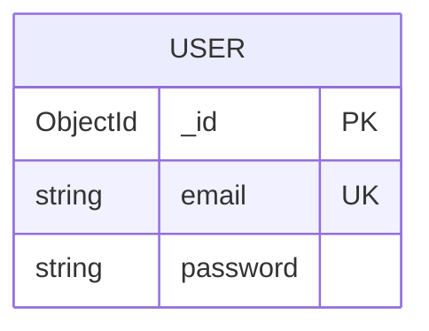

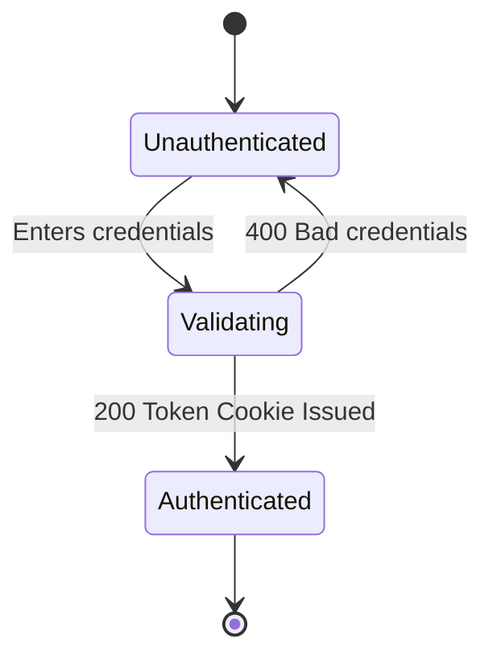

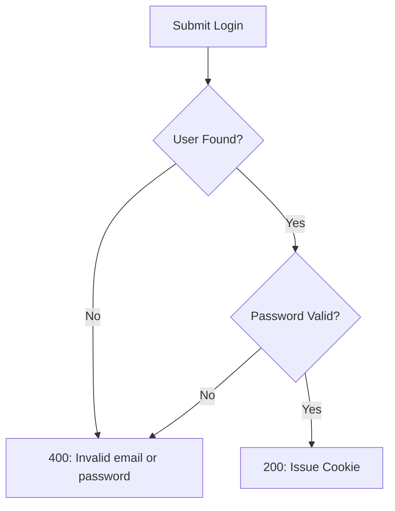

---

### F3: Consumer User Logout
* **User Experience:** Clears active consumer session.
* **Frontend Flow:** Triggered via GET request to `/api/auth/user/logout`.
* **API Call:** `GET http://localhost:3000/api/auth/user/logout`
* **Backend Flow:** [`auth.routes.js:9`](file:///Users/avishjain/avishjain9-repos/55-zomato-reel-feed/zomato/backend/src/routes/auth.routes.js#L9) -> `authController.logoutUser` in [`auth.controller.js:83-88`](file:///Users/avishjain/avishjain9-repos/55-zomato-reel-feed/zomato/backend/src/controllers/auth.controller.js#L83-L88).
  1. Calls `res.clearCookie("token")`.
  2. Returns HTTP 200 `{ message: "User logged out successfully" }`.
* **Database Operations:** None (stateless JWT invalidation via cookie deletion).

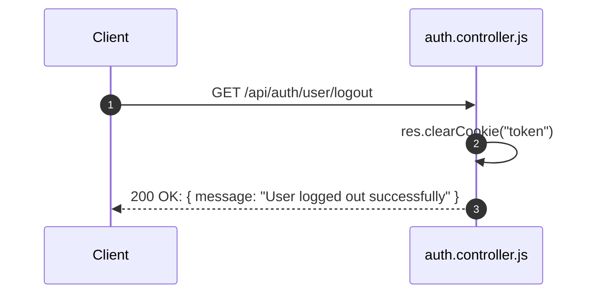

---

### F4: Food Partner Registration
* **User Experience:** Merchant visits `/food-partner/register` and fills Business Name, Contact Name, Phone, Email, Password, and Address. On success, redirected to `/create-food`.
* **Frontend Flow:** [`FoodPartnerRegister.jsx:11-36`](file:///Users/avishjain/avishjain9-repos/55-zomato-reel-feed/zomato/frontend/src/pages/auth/FoodPartnerRegister.jsx#L11-L36). Collects fields, calls Axios POST with `withCredentials: true`, then invokes `navigate("/create-food")`.
* **API Call:** `POST http://localhost:3000/api/auth/food-partner/register`
* **Backend Flow:** [`auth.routes.js:14`](file:///Users/avishjain/avishjain9-repos/55-zomato-reel-feed/zomato/backend/src/routes/auth.routes.js#L14) -> `authController.registerFoodPartner` ([`auth.controller.js:91-134`](file:///Users/avishjain/avishjain9-repos/55-zomato-reel-feed/zomato/backend/src/controllers/auth.controller.js#L91-L134)).
  1. Checks `foodPartnerModel.findOne({ email })`.
  2. Hashes password using `bcrypt.hash(password, 10)`.
  3. Inserts document into `foodpartners` collection.
  4. Signs JWT with partner `_id` and sets `token` cookie.
  5. Returns HTTP 201 with partner profile details.
* **Database Operations:** Uniqueness check on `foodpartners` collection by `email`, followed by insert.

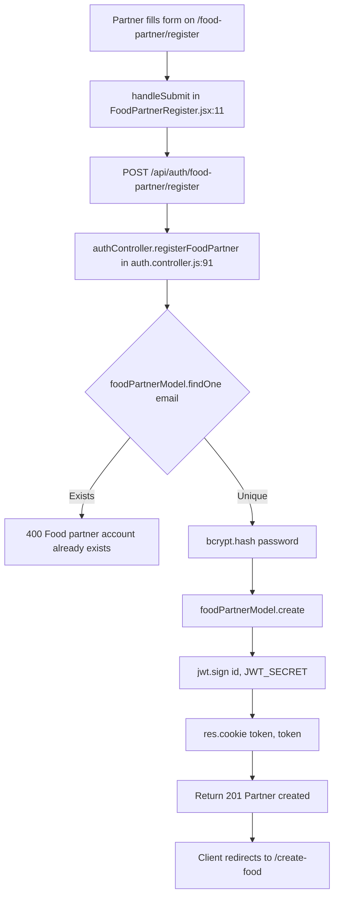

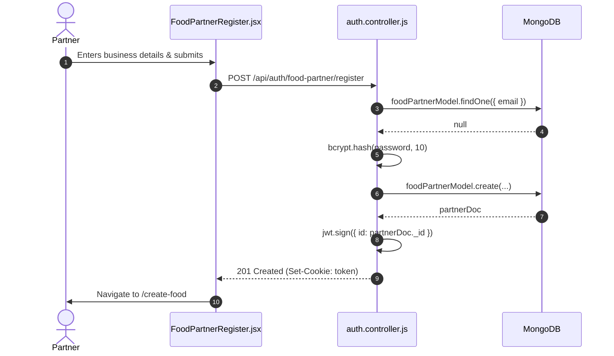

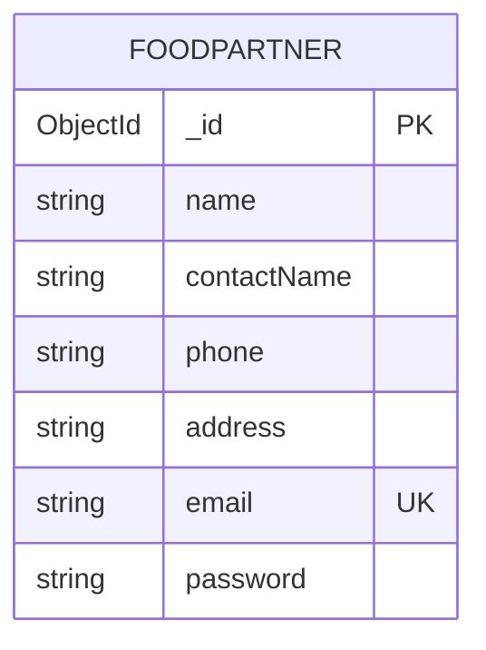

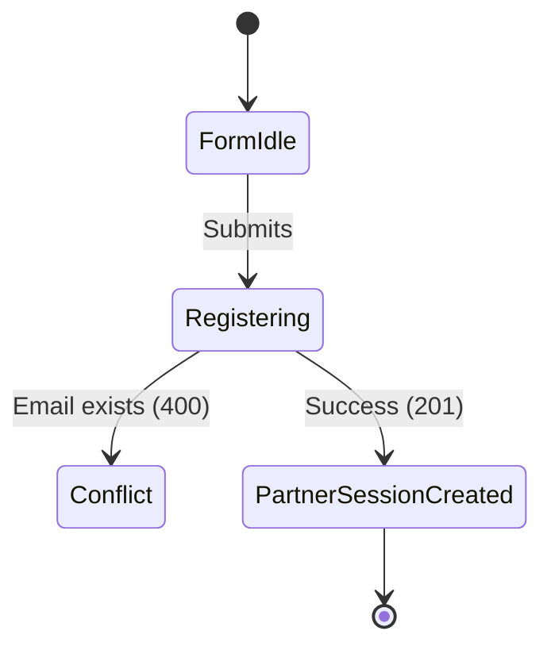

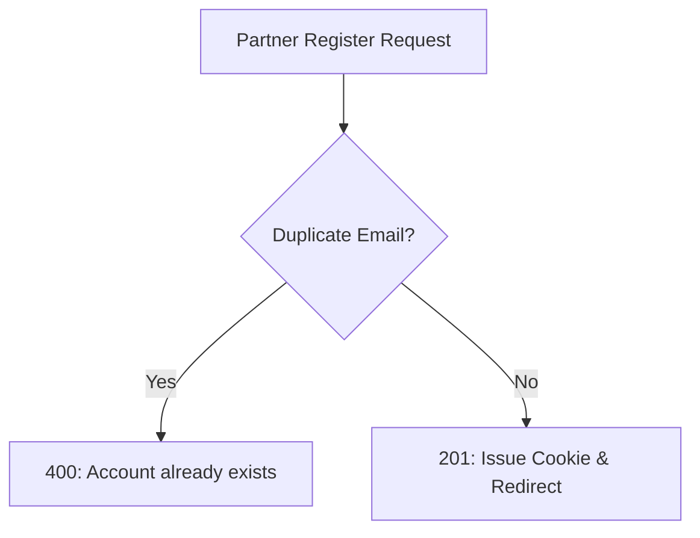

---

### F5: Food Partner Login
* **User Experience:** Merchant enters partner email and password on `/food-partner/login` and is redirected to `/create-food`.
* **Frontend Flow:** [`FoodPartnerLogin.jsx:10-25`](file:///Users/avishjain/avishjain9-repos/55-zomato-reel-feed/zomato/frontend/src/pages/auth/FoodPartnerLogin.jsx#L10-L25). Captures credentials, sends Axios POST, navigates to `/create-food`.
* **API Call:** `POST http://localhost:3000/api/auth/food-partner/login`
* **Backend Flow:** [`auth.routes.js:15`](file:///Users/avishjain/avishjain9-repos/55-zomato-reel-feed/zomato/backend/src/routes/auth.routes.js#L15) -> `authController.loginFoodPartner` ([`auth.controller.js:136-172`](file:///Users/avishjain/avishjain9-repos/55-zomato-reel-feed/zomato/backend/src/controllers/auth.controller.js#L136-L172)).
  1. Finds partner by email in `foodpartners`.
  2. Compares hash with `bcrypt.compare`.
  3. Signs JWT and issues `token` cookie.
  4. Returns HTTP 200 with partner details.

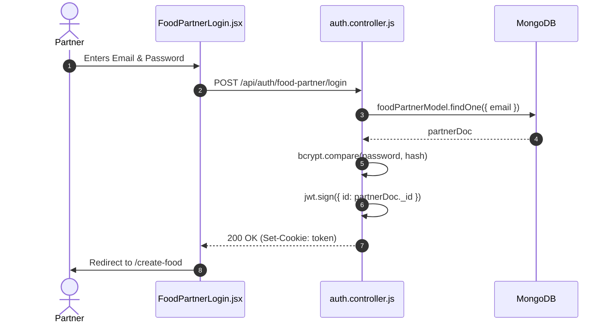

---

### F6: Food Partner Logout
* **User Experience:** Clears active food partner session.
* **Frontend Flow:** Request to `/api/auth/food-partner/logout`.
* **API Call:** `GET http://localhost:3000/api/auth/food-partner/logout`
* **Backend Flow:** [`auth.routes.js:16`](file:///Users/avishjain/avishjain9-repos/55-zomato-reel-feed/zomato/backend/src/routes/auth.routes.js#L16) -> [`auth.controller.js:174-179`](file:///Users/avishjain/avishjain9-repos/55-zomato-reel-feed/zomato/backend/src/controllers/auth.controller.js#L174-L179). Clears cookie `token` and returns 200 OK.

---

### F7: Video Reel Feed & Viewport Intersection Autoplay
* **User Experience:** Consumer opens `/` and views a full-screen vertical feed of food videos. Scrolling brings new videos into view; the video occupying the majority of the screen begins playing with audio muted and loops automatically. Off-screen videos pause immediately.
* **Frontend Flow:**
  1. [`Home.jsx:10-19`](file:///Users/avishjain/avishjain9-repos/55-zomato-reel-feed/zomato/frontend/src/pages/general/Home.jsx#L10-L19) executes `useEffect` on mount: `axios.get("http://localhost:3000/api/food", { withCredentials: true })`. Stores array in `videos` state.
  2. Renders `<ReelFeed items={videos} onLike={likeVideo} onSave={saveVideo} />` in [`ReelFeed.jsx`](file:///Users/avishjain/avishjain9-repos/55-zomato-reel-feed/zomato/frontend/src/components/ReelFeed.jsx).
  3. `ReelFeed.jsx` initializes `videoRefs = useRef(new Map())`.
  4. An `IntersectionObserver` with thresholds `[0, 0.25, 0.6, 0.9, 1]` monitors all video nodes:
     ```javascript
     if (entry.isIntersecting && entry.intersectionRatio >= 0.6) {
       video.play().catch(() => {});
     } else {
       video.pause();
     }
     ```
* **API Call:** `GET http://localhost:3000/api/food` (Cookie: token)
* **Backend Flow:** [`food.routes.js:21-23`](file:///Users/avishjain/avishjain9-repos/55-zomato-reel-feed/zomato/backend/src/routes/food.routes.js#L21-L23) -> `authMiddleware.authUserMiddleware` -> `foodController.getFoodItems` ([`food.controller.js:25-31`](file:///Users/avishjain/avishjain9-repos/55-zomato-reel-feed/zomato/backend/src/controllers/food.controller.js#L25-L31)).
  1. `authUserMiddleware` validates JWT from `req.cookies.token`, queries `userModel.findById(decoded.id)`, attaches `req.user`.
  2. `foodModel.find({})` retrieves all food documents.
  3. Returns HTTP 200 `{ message: "Food items fetched successfully", foodItems }`.
* **Database Operations:** Query `db.foods.find({})` on the `foods` collection.
* **External Calls:** Browser requests video streams directly from ImageKit CDN endpoints (`item.video`).

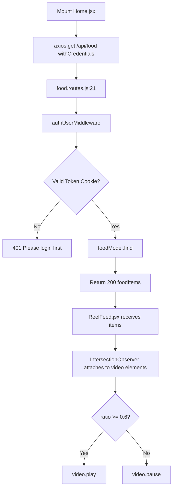

```mermaid
sequenceDiagram
    autonumber
    actor U as User
    participant RF as ReelFeed.jsx
    participant H as Home.jsx
    participant S as food.controller.js
    participant DB as MongoDB
    participant CDN as ImageKit CDN

    U->>H: Navigates to /
    H->>S: GET /api/food
    S->>DB: foodModel.find({})
    DB-->>S: [foodItems]
    S-->>H: 200 OK: { foodItems }
    H->>RF: items={videos}
    RF->>CDN: Fetch video metadata & stream chunks
    RF->>RF: IntersectionObserver triggers at 60% viewport
    RF->>U: Video autoplays smoothly
```

```mermaid
erDiagram
    FOOD {
        ObjectId _id PK
        string name
        string video
        string description
        ObjectId foodPartner FK
        number likeCount
        number savesCount
    }
```

```mermaid
stateDiagram-v2
    [*] --> Idle
    Idle --> LoadingFeed : Mount Home.jsx
    LoadingFeed --> FeedReady : 200 OK
    LoadingFeed --> AuthRequired : 401 Unauthorized
    FeedReady --> VideoPaused : Offscreen (<60%)
    VideoPaused --> VideoPlaying : Viewport >= 60%
    VideoPlaying --> VideoPaused : Scrolled away
```

```mermaid
flowchart TD
    FReq[Fetch Feed Request] --> AuthCheck{JWT Valid?}
    AuthCheck -- Invalid/Missing --> Err401[401: Please login first]
    AuthCheck -- Valid --> DBFetch{DB Query}
    DBFetch -- Fail --> Err500[500: Database Query Failure]
    DBFetch -- Success --> VidStream{CDN Video Stream}
    VidStream -- Blocked/Autoplay Policy --> AutoCatch[video.play catch ignore]
    VidStream -- Success --> PlayOK[Playing inline loop]
```

---

### F8: Reel Like / Unlike (Atomic Counter Toggle)
* **User Experience:** Consumer taps the Heart button on a reel. If unliked, the heart count increments by 1. If previously liked, tapping again unlikes it and decrements the counter by 1.
* **Frontend Flow:** [`Home.jsx:23-35`](file:///Users/avishjain/avishjain9-repos/55-zomato-reel-feed/zomato/frontend/src/pages/general/Home.jsx#L23-L35).
  1. Calls `axios.post("http://localhost:3000/api/food/like", { foodId: item._id }, { withCredentials: true })`.
  2. Inspects `response.data.like`:
     - If truthy (liked): `setVideos(prev => prev.map(v => v._id === item._id ? { ...v, likeCount: v.likeCount + 1 } : v))`.
     - If falsy (unliked): decrements `likeCount - 1`.
* **API Call:** `POST http://localhost:3000/api/food/like` (Payload: `{ foodId }`)
* **Backend Flow:** [`food.routes.js:26-28`](file:///Users/avishjain/avishjain9-repos/55-zomato-reel-feed/zomato/backend/src/routes/food.routes.js#L26-L28) -> `authUserMiddleware` -> `foodController.likeFood` ([`food.controller.js:34-72`](file:///Users/avishjain/avishjain9-repos/55-zomato-reel-feed/zomato/backend/src/controllers/food.controller.js#L34-L72)).
  1. Checks if already liked: `likeModel.findOne({ user: user._id, food: foodId })`.
  2. If found:
     - `likeModel.deleteOne({ user: user._id, food: foodId })`.
     - `foodModel.findByIdAndUpdate(foodId, { $inc: { likeCount: -1 } })`.
     - Returns HTTP 200 `{ message: "Food unliked successfully" }`.
  3. If not found:
     - `likeModel.create({ user: user._id, food: foodId })`.
     - `foodModel.findByIdAndUpdate(foodId, { $inc: { likeCount: 1 } })`.
     - Returns HTTP 201 `{ message: "Food liked successfully", like }`.
* **Database Operations:** Read on `likes`, followed by either `deleteOne` + `$inc: -1` or `create` + `$inc: 1`.

```mermaid
flowchart TD
    A[User taps Heart button] --> B[Home.jsx: likeVideo]
    B --> C[POST /api/food/like with foodId]
    C --> D[authUserMiddleware: verify JWT]
    D --> E[foodController.likeFood in food.controller.js:34]
    E --> F{likeModel.findOne user, food}
    F -- Found --> G[likeModel.deleteOne]
    G --> H[foodModel.findByIdAndUpdate $inc: -1]
    H --> I[Return 200 Food unliked]
    F -- Not Found --> J[likeModel.create]
    J --> K[foodModel.findByIdAndUpdate $inc: +1]
    K --> L[Return 201 Food liked]
    I --> M[Frontend: likeCount - 1]
    L --> N[Frontend: likeCount + 1]
```

```mermaid
sequenceDiagram
    autonumber
    actor U as User
    participant C as Home.jsx
    participant Ctrl as food.controller.js
    participant LikeDB as likes Collection
    participant FoodDB as foods Collection

    U->>C: Clicks Heart Button
    C->>Ctrl: POST /api/food/like { foodId }
    Ctrl->>LikeDB: findOne({ user: user._id, food: foodId })
    alt Already Liked
        LikeDB-->>Ctrl: likeRecord
        Ctrl->>LikeDB: deleteOne({ user, food })
        Ctrl->>FoodDB: findByIdAndUpdate(foodId, { $inc: { likeCount: -1 } })
        Ctrl-->>C: 200 OK (Unliked)
        C->>C: likeCount - 1
    else Not Liked Yet
        LikeDB-->>Ctrl: null
        Ctrl->>LikeDB: create({ user, food })
        Ctrl->>FoodDB: findByIdAndUpdate(foodId, { $inc: { likeCount: 1 } })
        Ctrl-->>C: 201 Created (Liked)
        C->>C: likeCount + 1
    end
```

```mermaid
erDiagram
    USER ||--o{ LIKE : creates
    FOOD ||--o{ LIKE : receives
    LIKE {
        ObjectId _id PK
        ObjectId user FK
        ObjectId food FK
        date createdAt
    }
```

```mermaid
stateDiagram-v2
    [*] --> Unliked
    Unliked --> Liking : Tap Heart
    Liking --> Liked : 201 Created ($inc +1)
    Liked --> Unliking : Tap Heart
    Unliking --> Unliked : 200 OK ($inc -1)
```

```mermaid
flowchart TD
    LReq[Like Request] --> LAuth{Auth Valid?}
    LAuth -- No --> LErr1[401: Please login first]
    LAuth -- Yes --> LDB{MongoDB Operation}
    LDB -- Network Timeout --> LErr2[500: Database Timeout]
    LDB -- Success --> LToggle[Toggle Success]
```

---

### F9: Reel Save / Bookmark (Atomic Counter Toggle)
* **User Experience:** Consumer taps the Bookmark icon to save a food video for later. Tapping again removes it from saved bookmarks.
* **Frontend Flow:** [`Home.jsx:37-45`](file:///Users/avishjain/avishjain9-repos/55-zomato-reel-feed/zomato/frontend/src/pages/general/Home.jsx#L37-L45) sends POST to `/api/food/save` with `{ foodId }`. Updates `savesCount` in local state.
* **API Call:** `POST http://localhost:3000/api/food/save`
* **Backend Flow:** [`food.routes.js:31-34`](file:///Users/avishjain/avishjain9-repos/55-zomato-reel-feed/zomato/backend/src/routes/food.routes.js#L31-L34) -> `authUserMiddleware` -> `foodController.saveFood` ([`food.controller.js:74-113`](file:///Users/avishjain/avishjain9-repos/55-zomato-reel-feed/zomato/backend/src/controllers/food.controller.js#L74-L113)).
  1. Checks `saveModel.findOne({ user: user._id, food: foodId })`.
  2. If exists: deletes record and `$inc: { savesCount: -1 }`. Returns 200.
  3. If not exists: creates record and `$inc: { savesCount: 1 }`. Returns 201.

```mermaid
sequenceDiagram
    autonumber
    actor U as User
    participant C as Home.jsx
    participant Ctrl as food.controller.js
    participant SDB as saves Collection
    participant FDB as foods Collection

    U->>C: Clicks Bookmark Button
    C->>Ctrl: POST /api/food/save { foodId }
    Ctrl->>SDB: findOne({ user, food })
    alt Already Saved
        SDB-->>Ctrl: saveRecord
        Ctrl->>SDB: deleteOne({ user, food })
        Ctrl->>FDB: findByIdAndUpdate(foodId, { $inc: { savesCount: -1 } })
        Ctrl-->>C: 200 OK (Unsaved)
        C->>C: savesCount - 1
    else Not Saved Yet
        SDB-->>Ctrl: null
        Ctrl->>SDB: create({ user, food })
        Ctrl->>FDB: findByIdAndUpdate(foodId, { $inc: { savesCount: 1 } })
        Ctrl-->>C: 201 Created (Saved)
        C->>C: savesCount + 1
    end
```

---

### F10: Saved Reels Collection Screen
* **User Experience:** Consumer navigates to `/saved` (via bottom navigation) and views only their personally bookmarked food videos.
* **Frontend Flow:** [`Saved.jsx:9-23`](file:///Users/avishjain/avishjain9-repos/55-zomato-reel-feed/zomato/frontend/src/pages/general/Saved.jsx#L9-L23) calls `axios.get("http://localhost:3000/api/food/save", { withCredentials: true })`. Maps `response.data.savedFoods.map(item => item.food)` to feed items.
* **API Call:** `GET http://localhost:3000/api/food/save`
* **Backend Flow:** [`food.routes.js:37-40`](file:///Users/avishjain/avishjain9-repos/55-zomato-reel-feed/zomato/backend/src/routes/food.routes.js#L37-L40) -> `authUserMiddleware` -> `foodController.getSaveFood` ([`food.controller.js:115-130`](file:///Users/avishjain/avishjain9-repos/55-zomato-reel-feed/zomato/backend/src/controllers/food.controller.js#L115-L130)).
  1. Executes `saveModel.find({ user: user._id }).populate('food')`.
  2. If empty, returns HTTP 404 `{ message: "No saved foods found" }`.
  3. Otherwise returns HTTP 200 `{ message: "Saved foods retrieved successfully", savedFoods }`.
* **Database Operations:** Query on `saves` collection with Mongoose `$lookup` population on `foods`.

```mermaid
sequenceDiagram
    autonumber
    participant C as Saved.jsx
    participant Ctrl as food.controller.js
    participant DB as MongoDB

    C->>Ctrl: GET /api/food/save (Cookie: token)
    Ctrl->>DB: saveModel.find({ user }).populate('food')
    DB-->>Ctrl: [ { _id, user, food: { name, video, ... } } ]
    Ctrl-->>C: 200 OK: { savedFoods }
    C->>C: Normalizes array and renders ReelFeed
```

---

### F11: Food Video Upload & Cloud Storage via ImageKit CDN
* **User Experience:** Food partner navigates to `/create-food`, selects or drops a video file (MP4/WebM), enters dish name and description, views an instant local preview, and clicks "Save Food".
* **Frontend Flow:** [`CreateFood.jsx:50-67`](file:///Users/avishjain/avishjain9-repos/55-zomato-reel-feed/zomato/frontend/src/pages/food-partner/CreateFood.jsx#L50-L67).
  1. `URL.createObjectURL(videoFile)` creates in-browser blob preview.
  2. Constructs `FormData()`: `formData.append('name', name)`, `formData.append('description', description)`, `formData.append('mama', videoFile)`.
  3. Sends `axios.post("http://localhost:3000/api/food", formData, { withCredentials: true })`.
  4. On completion, redirects to `/`.
* **API Call:** `POST http://localhost:3000/api/food` (multipart/form-data)
* **Backend Flow:** [`food.routes.js:14-17`](file:///Users/avishjain/avishjain9-repos/55-zomato-reel-feed/zomato/backend/src/routes/food.routes.js#L14-L17).
  1. Middleware 1: `authMiddleware.authFoodPartnerMiddleware` validates partner token, loads `req.foodPartner`.
  2. Middleware 2: `upload.single("mama")` (Multer memory storage) reads binary stream into `req.file.buffer`.
  3. Controller: `foodController.createFood` in [`food.controller.js:8-23`](file:///Users/avishjain/avishjain9-repos/55-zomato-reel-feed/zomato/backend/src/controllers/food.controller.js#L8-L23).
  4. Calls `storageService.uploadFile(req.file.buffer, uuid())` in [`storage.service.js:9-16`](file:///Users/avishjain/avishjain9-repos/55-zomato-reel-feed/zomato/backend/src/services/storage.service.js#L9-L16).
  5. ImageKit uploads file buffer and returns CDN URL.
  6. Inserts into MongoDB: `foodModel.create({ name, description, video: fileUploadResult.url, foodPartner: req.foodPartner._id })`.
  7. Returns HTTP 201 `{ message: "food created successfully", food: foodItem }`.

```mermaid
flowchart TD
    A[Partner drops video on /create-food] --> B[CreateFood.jsx: URL.createObjectURL preview]
    B --> C[Partner clicks Save Food]
    C --> D[POST /api/food with FormData key 'mama']
    D --> E[authFoodPartnerMiddleware: verify partner token]
    E --> F[Multer memoryStorage: buffer in req.file.buffer]
    F --> G[foodController.createFood]
    G --> H[storageService.uploadFile with uuid]
    H --> I[ImageKit SDK uploads buffer]
    I --> J[ImageKit returns CDN URL]
    J --> K[foodModel.create in MongoDB]
    K --> L[Return 201 food created successfully]
    L --> M[Frontend: navigate to /]
```

```mermaid
sequenceDiagram
    autonumber
    actor P as Partner
    participant C as CreateFood.jsx
    participant M as Multer Middleware
    participant S as food.controller.js
    participant IK as ImageKit Cloud
    participant DB as MongoDB

    P->>C: Selects video, name, description
    C->>C: Blob preview via createObjectURL
    P->>C: Submits Form
    C->>M: POST /api/food (multipart/form-data)
    M->>M: Memory buffer created in req.file.buffer
    M->>S: createFood(req, res)
    S->>IK: uploadFile(req.file.buffer, uuid())
    IK-->>S: { url: "https://ik.imagekit.io/..." }
    S->>DB: foodModel.create({ name, description, video, foodPartner })
    DB-->>S: foodDoc
    S-->>C: 201 Created: { food: foodDoc }
    C->>P: Redirect to /
```

```mermaid
erDiagram
    FOODPARTNER ||--o{ FOOD : publishes
    FOOD {
        ObjectId _id PK
        string name
        string video
        string description
        ObjectId foodPartner FK
        number likeCount
        number savesCount
    }
```

```mermaid
stateDiagram-v2
    [*] --> SelectingFile
    SelectingFile --> Previewing : File Chosen
    Previewing --> Uploading : Click Save Food
    Uploading --> ImageKitProcessing : Multer Buffer -> ImageKit
    ImageKitProcessing --> DatabasePersisting : CDN URL returned
    DatabasePersisting --> Published : 201 Created
    Published --> [*]
```

```mermaid
flowchart TD
    Upl[Client Upload] --> MulterTrap{File Present & Field 'mama'?}
    MulterTrap -- No --> MErr[Multer Exception / Crash]
    MulterTrap -- Yes --> AuthTrap{Is FoodPartner?}
    AuthTrap -- No --> AErr[401: Please login first / Invalid token]
    AuthTrap -- Yes --> IKTrap{ImageKit API Available?}
    IKTrap -- Bad Keys / Timeout --> IKErr[500: ImageKit Upload Error]
    IKTrap -- Success --> DBErr{MongoDB Write}
    DBErr -- Fail --> D500[500: Database insert failure]
    DBErr -- Success --> U201[201: Food created]
```

---

### F12: Food Partner Public Profile & Video Grid Catalog
* **User Experience:** Consumer taps "Visit store" on any reel, opening `/food-partner/:id`. Displays merchant avatar, business name, address, stats pills ("total meals", "customer served"), and a grid of all video reels published by this partner.
* **Frontend Flow:** [`Profile.jsx:11-18`](file:///Users/avishjain/avishjain9-repos/55-zomato-reel-feed/zomato/frontend/src/pages/food-partner/Profile.jsx#L11-L18). Reads `:id` using `useParams()`. Calls `axios.get("http://localhost:3000/api/food-partner/${id}", { withCredentials: true })`. Stores profile and `foodPartner.foodItems` in state.
* **API Call:** `GET http://localhost:3000/api/food-partner/:id`
* **Backend Flow:** [`food-partner.routes.js:9-11`](file:///Users/avishjain/avishjain9-repos/55-zomato-reel-feed/zomato/backend/src/routes/food-partner.routes.js#L9-L11) -> `authUserMiddleware` -> `foodPartnerController.getFoodPartnerById` ([`food-partner.controller.js:4-23`](file:///Users/avishjain/avishjain9-repos/55-zomato-reel-feed/zomato/backend/src/controllers/food-partner.controller.js#L4-L23)).
  1. `foodPartnerModel.findById(foodPartnerId)`.
  2. `foodModel.find({ foodPartner: foodPartnerId })`.
  3. If partner not found, returns HTTP 404 `{ message: "Food partner not found" }`.
  4. Returns HTTP 200 `{ message: "Food partner retrieved successfully", foodPartner: { ...partner, foodItems } }`.

```mermaid
sequenceDiagram
    autonumber
    actor U as User
    participant P as Profile.jsx
    participant Ctrl as food-partner.controller.js
    participant PDB as foodpartners Collection
    participant FDB as foods Collection

    U->>P: Clicks "Visit store" (/food-partner/:id)
    P->>Ctrl: GET /api/food-partner/:id
    Ctrl->>PDB: findById(foodPartnerId)
    Ctrl->>FDB: find({ foodPartner: foodPartnerId })
    PDB-->>Ctrl: partnerDoc
    FDB-->>Ctrl: [food1, food2]
    Ctrl-->>P: 200 OK: { foodPartner: { ...partner, foodItems } }
    P->>U: Renders merchant header & video grid
```

---

### F13: Navigation & Multi-Role Route Switching
* **User Experience:** Bottom navigation bar allows switching between Home (`/`) and Bookmarks (`/saved`). Role selector screen (`/register`) directs user to either consumer sign-up or merchant onboarding.
* **Frontend Implementation:** [`BottomNav.jsx:9-29`](file:///Users/avishjain/avishjain9-repos/55-zomato-reel-feed/zomato/frontend/src/components/BottomNav.jsx#L9-L29) uses `NavLink` with dynamic `isActive` class toggling. `ChooseRegister.jsx` provides links to `/user/register` and `/food-partner/register`.

---

### F14: Cross-Origin Resource Sharing (CORS) with Credentials
* **User Experience:** Seamless API requests between Vite client (`http://localhost:5173`) and Express server (`http://localhost:3000`) without CORS blockades or lost cookies.
* **Backend Implementation:** [`app.js:10-13`](file:///Users/avishjain/avishjain9-repos/55-zomato-reel-feed/zomato/backend/src/app.js#L10-L13):
  ```javascript
  app.use(cors({
      origin: "http://localhost:5173",
      credentials: true
  }));
  ```
* **Frontend Implementation:** All Axios calls explicitly configure `{ withCredentials: true }`.

---

### F15: Protected Route Middlewares (Consumer & Partner Gates)
* **User Experience:** Unauthenticated requests receive HTTP 401 and cannot read feeds, like, bookmark, or upload videos.
* **Backend Implementation:** [`auth.middleware.js:6-62`](file:///Users/avishjain/avishjain9-repos/55-zomato-reel-feed/zomato/backend/src/middlewares/auth.middleware.js#L6-L62):
  1. `authFoodPartnerMiddleware`: verifies token, executes `foodPartnerModel.findById(decoded.id)`, assigns `req.foodPartner`.
  2. `authUserMiddleware`: verifies token, executes `userModel.findById(decoded.id)`, assigns `req.user`.

---

## 0.3 Every API

### Backend REST API Endpoints

| Method | Endpoint Path | Auth Required | Controller & Handler | Purpose |
|---|---|---|---|---|
| `GET` | `/` | None | Direct inline handler | Server liveness check; returns `"Hello World"` |
| `POST` | `/api/auth/user/register` | None | `authController.registerUser` | Register consumer account & set JWT cookie |
| `POST` | `/api/auth/user/login` | None | `authController.loginUser` | Authenticate consumer & set JWT cookie |
| `GET` | `/api/auth/user/logout` | None | `authController.logoutUser` | Clear consumer `token` cookie |
| `POST` | `/api/auth/food-partner/register` | None | `authController.registerFoodPartner` | Register restaurant partner & set JWT cookie |
| `POST` | `/api/auth/food-partner/login` | None | `authController.loginFoodPartner` | Authenticate restaurant partner & set JWT cookie |
| `GET` | `/api/auth/food-partner/logout` | None | `authController.logoutFoodPartner` | Clear partner `token` cookie |
| `POST` | `/api/food` | `authFoodPartnerMiddleware` + Multer | `foodController.createFood` | Upload video reel to ImageKit & persist food item |
| `GET` | `/api/food` | `authUserMiddleware` | `foodController.getFoodItems` | Fetch all food items for main feed |
| `POST` | `/api/food/like` | `authUserMiddleware` | `foodController.likeFood` | Toggle like/unlike on food item with atomic `$inc` |
| `POST` | `/api/food/save` | `authUserMiddleware` | `foodController.saveFood` | Toggle bookmark on food item with atomic `$inc` |
| `GET` | `/api/food/save` | `authUserMiddleware` | `foodController.getSaveFood` | Retrieve user's saved food reels (populated) |
| `GET` | `/api/food-partner/:id` | `authUserMiddleware` | `foodPartnerController.getFoodPartnerById` | Fetch merchant profile metadata & associated food items |

### External APIs & SDKs

| Provider | Purpose | Where Called in Code | Credentials Used |
|---|---|---|---|
| **ImageKit Media Cloud** | Upload video buffer, auto-transcode, and generate global CDN delivery URL | [`zomato/backend/src/services/storage.service.js:9-16`](file:///Users/avishjain/avishjain9-repos/55-zomato-reel-feed/zomato/backend/src/services/storage.service.js#L9-L16) | `IMAGEKIT_PUBLIC_KEY`, `IMAGEKIT_PRIVATE_KEY`, `IMAGEKIT_URL_ENDPOINT` |

### Environment Variables & Secrets Inventory

| Variable Name | Service | Purpose | Where Read | How to Obtain |
|---|---|---|---|---|
| `JWT_SECRET` | Internal | Digital signature secret for auth tokens | `auth.controller.js`, `auth.middleware.js` | Run `openssl rand -base64 32` |
| `MONGODB_URI` | MongoDB Atlas | Cluster connection string URI | `src/db/db.js` | MongoDB Atlas Console |
| `IMAGEKIT_PUBLIC_KEY` | ImageKit | Account public API identifier | `storage.service.js` | ImageKit Dashboard -> API Keys |
| `IMAGEKIT_PRIVATE_KEY` | ImageKit | Cloud upload private authorization key | `storage.service.js` | ImageKit Dashboard -> API Keys |
| `IMAGEKIT_URL_ENDPOINT` | ImageKit | CDN base URL prefix | `storage.service.js` | ImageKit Dashboard -> API Keys |

---

## 0.4 Every Hook, Helper, and Shared Piece

### React Hooks Used in Frontend
1. **`useRef`**:
   - [`ReelFeed.jsx:11`](file:///Users/avishjain/avishjain9-repos/55-zomato-reel-feed/zomato/frontend/src/components/ReelFeed.jsx#L11): Holds `Map()` of video DOM elements to manage `IntersectionObserver` bindings without triggering component re-renders.
   - [`CreateFood.jsx:12`](file:///Users/avishjain/avishjain9-repos/55-zomato-reel-feed/zomato/frontend/src/pages/food-partner/CreateFood.jsx#L12): References hidden file `<input>` to allow custom styled dropzone click triggers.
2. **`useEffect`**:
   - [`ReelFeed.jsx:13-31`](file:///Users/avishjain/avishjain9-repos/55-zomato-reel-feed/zomato/frontend/src/components/ReelFeed.jsx#L13-L31): Instantiates and cleans up `IntersectionObserver` observing video elements on `items` prop changes.
   - [`Home.jsx:10-19`](file:///Users/avishjain/avishjain9-repos/55-zomato-reel-feed/zomato/frontend/src/pages/general/Home.jsx#L10-L19): Fetches food feed on initial mount.
   - [`Saved.jsx:9-23`](file:///Users/avishjain/avishjain9-repos/55-zomato-reel-feed/zomato/frontend/src/pages/general/Saved.jsx#L9-L23): Fetches bookmarked food items on initial mount.
   - [`CreateFood.jsx:16-24`](file:///Users/avishjain/avishjain9-repos/55-zomato-reel-feed/zomato/frontend/src/pages/food-partner/CreateFood.jsx#L16-L24): Creates blob preview URL with `URL.createObjectURL(videoFile)` and revokes it with `URL.revokeObjectURL(url)` on cleanup.
   - [`Profile.jsx:11-17`](file:///Users/avishjain/avishjain9-repos/55-zomato-reel-feed/zomato/frontend/src/pages/food-partner/Profile.jsx#L11-L17): Fetches partner metadata and video items whenever `:id` param changes.
3. **`useState`**:
   - Manages local feed items (`videos`), form inputs (`name`, `description`, `videoFile`), file upload errors (`fileError`), and partner profiles (`profile`).
4. **`useMemo`**:
   - [`CreateFood.jsx:69`](file:///Users/avishjain/avishjain9-repos/55-zomato-reel-feed/zomato/frontend/src/pages/food-partner/CreateFood.jsx#L69): Computes submit button disabled state `!name.trim() || !videoFile`.
5. **`useNavigate` & `useParams` (React Router DOM v7)**:
   - Programmatic client navigation and URL route parameter extraction.

### Backend Middlewares
1. **`cors`**: [`app.js:10-13`](file:///Users/avishjain/avishjain9-repos/55-zomato-reel-feed/zomato/backend/src/app.js#L10-L13). Binds origin `http://localhost:5173` with credentials support.
2. **`cookieParser`**: [`app.js:14`](file:///Users/avishjain/avishjain9-repos/55-zomato-reel-feed/zomato/backend/src/app.js#L14). Populates `req.cookies`.
3. **`express.json`**: [`app.js:15`](file:///Users/avishjain/avishjain9-repos/55-zomato-reel-feed/zomato/backend/src/app.js#L15). Parses incoming JSON request bodies.
4. **`upload.single("mama")` (Multer)**: [`food.routes.js:8-10,16`](file:///Users/avishjain/avishjain9-repos/55-zomato-reel-feed/zomato/backend/src/routes/food.routes.js#L8-L10). Parses multipart video files into memory buffer.
5. **`authFoodPartnerMiddleware`**: [`auth.middleware.js:6-33`](file:///Users/avishjain/avishjain9-repos/55-zomato-reel-feed/zomato/backend/src/middlewares/auth.middleware.js#L6-L33). Verifies partner JWT and loads `req.foodPartner`.
6. **`authUserMiddleware`**: [`auth.middleware.js:35-62`](file:///Users/avishjain/avishjain9-repos/55-zomato-reel-feed/zomato/backend/src/middlewares/auth.middleware.js#L35-L62). Verifies consumer JWT and loads `req.user`.

---

## 0.5 Every Connection

1. **Frontend to Backend:**
   - Transport: HTTP/1.1 over TCP via Axios.
   - Base URL: `http://localhost:3000`.
   - Security: `withCredentials: true` sends the `token` cookie across origins.
2. **Backend to Database:**
   - Mongoose connects to `process.env.MONGODB_URI` in [`db.js:6`](file:///Users/avishjain/avishjain9-repos/55-zomato-reel-feed/zomato/backend/src/db/db.js#L6).
   - Models: `user`, `foodpartner`, `food`, `like`, `save`.
3. **Backend to ImageKit Cloud:**
   - In [`storage.service.js`](file:///Users/avishjain/avishjain9-repos/55-zomato-reel-feed/zomato/backend/src/services/storage.service.js), `imagekit.upload()` pushes the video buffer with a generated UUID filename and receives a secure HTTPS CDN URL.
4. **Backend to AI Provider:**
   - **Current Code Status:** **Not implemented** (No AI provider called).
   - **Production Architecture:** Express service integration with Google Gemini Flash Multimodal API to process video frames for dish classification and ingredient tagging.
5. **Real-Time Connections:**
   - **Current Code Status:** **Not implemented** (Feed relies on client HTTP polling/refetch).
   - **Production Architecture:** WebSockets (Socket.io) or Server-Sent Events (SSE) for live view counts and order notifications.
6. **Authentication Lifecycle:**
   - Token creation: `jwt.sign({ id }, process.env.JWT_SECRET)` in `auth.controller.js`.
   - Storage: Set via `res.cookie("token", token)`.
   - Verification: `jwt.verify(token, process.env.JWT_SECRET)` in `auth.middleware.js`.
   - Destruction: `res.clearCookie("token")` in `auth.controller.js`.

---

## 0.6 Everything Else Built Into the Website

* **Form Validation:** Client-side HTML5 input validation (`required`, `type="email"`, `noValidate`) and backend uniqueness verification on email fields.
* **File Drag-and-Drop Dropzone:** In [`CreateFood.jsx:34-48`](file:///Users/avishjain/avishjain9-repos/55-zomato-reel-feed/zomato/frontend/src/pages/food-partner/CreateFood.jsx#L34-L48), native `onDrop` and `onDragOver` event handlers validate `file.type.startsWith('video/')` before accepting uploads.
* **Theme System:** [`theme.css`](file:///Users/avishjain/avishjain9-repos/55-zomato-reel-feed/zomato/frontend/src/styles/theme.css) defines CSS custom properties (`--color-bg`, `--color-surface`, `--color-accent`) with automatic dark-mode adjustments via `@media (prefers-color-scheme: dark)`.
* **Snap-Scrolling Mobile Feed Layout:** [`reels.css`](file:///Users/avishjain/avishjain9-repos/55-zomato-reel-feed/zomato/frontend/src/styles/reels.css) uses CSS scroll-snap (`scroll-snap-type: y mandatory`, `scroll-snap-align: start`) for authentic mobile reel paging.

---

## 0.7 Master Connection Map

```mermaid
flowchart TB
    subgraph ClientBrowser [Browser Client: React 19 SPA :5173]
        AppRoutes[AppRoutes.jsx]
        Home[Home.jsx]
        Saved[Saved.jsx]
        ReelFeed[ReelFeed.jsx]
        CreateFood[CreateFood.jsx]
        Profile[Profile.jsx]
        AuthPages[User/Partner Auth Pages]
    end

    subgraph BackendAPI [Express 5 Backend :3000]
        App[app.js CORS & CookieParser]
        AuthRoutes[auth.routes.js]
        FoodRoutes[food.routes.js]
        PartnerRoutes[food-partner.routes.js]
        AuthMiddleware[auth.middleware.js]
        MulterMem[Multer Memory Storage]
        AuthCtrl[auth.controller.js]
        FoodCtrl[food.controller.js]
        PartnerCtrl[food-partner.controller.js]
        StorageSvc[storage.service.js]
    end

    subgraph CloudServices [External Cloud Infrastructure]
        IK[ImageKit.io Media CDN]
        MongoAtlas[(MongoDB Atlas Database)]
    end

    Home -->|GET /api/food| App
    Home -->|POST /api/food/like| App
    Home -->|POST /api/food/save| App
    Saved -->|GET /api/food/save| App
    CreateFood -->|POST /api/food multipart| App
    Profile -->|GET /api/food-partner/:id| App
    AuthPages -->|POST /api/auth/...| App

    App --> AuthRoutes & FoodRoutes & PartnerRoutes
    FoodRoutes --> AuthMiddleware
    FoodRoutes --> MulterMem
    PartnerRoutes --> AuthMiddleware
    AuthRoutes --> AuthCtrl
    FoodRoutes --> FoodCtrl
    PartnerRoutes --> PartnerCtrl

    FoodCtrl --> StorageSvc
    StorageSvc -->|HTTPS Upload Buffer| IK
    IK -- Return CDN URL --> StorageSvc

    AuthCtrl & FoodCtrl & PartnerCtrl --> MongoAtlas
    ReelFeed -.->|Stream MP4 Video| IK
```

---

## 0.8 Final Inventory Counts

To ensure exact architectural consistency across all subsequent documentation steps, here is the verified inventory count:

| Category | Exact Count | Items Included |
|---|---|---|
| **Total Pages / Screens** | **9** | `ChooseRegister`, `UserRegister`, `UserLogin`, `FoodPartnerRegister`, `FoodPartnerLogin`, `Home`, `Saved`, `CreateFood`, `Profile` |
| **Total Frontend Components** | **2** | `ReelFeed.jsx`, `BottomNav.jsx` |
| **Total React Hooks Utilized** | **5** | `useRef`, `useEffect`, `useState`, `useMemo` (React 19) + `useNavigate`/`useParams` (React Router DOM) |
| **Total Features Documented** | **15** | F1 to F15 (F1-F6 Auth, F7-F10 Reels/Interactions, F11 Creation, F12 Profile, F13-F15 Infra/Middleware) |
| **Total Backend Endpoints** | **13** | Root `/`, 6 Auth routes, 5 Food routes, 1 FoodPartner route |
| **Total Mongoose Models** | **5** | `userModel`, `foodPartnerModel`, `foodModel`, `likeModel`, `saveModel` |
| **Total Express Middlewares** | **6** | `cors`, `cookieParser`, `express.json`, `upload.single('mama')`, `authFoodPartnerMiddleware`, `authUserMiddleware` |
| **Total External Cloud Services** | **2** | MongoDB Atlas (Database), ImageKit.io (Media CDN) |
| **Total Environment Variables** | **5** | `JWT_SECRET`, `MONGODB_URI`, `IMAGEKIT_PUBLIC_KEY`, `IMAGEKIT_PRIVATE_KEY`, `IMAGEKIT_URL_ENDPOINT` |
| **Backend Dependencies** | **10** | `bcryptjs`, `cookie-parser`, `cors`, `dotenv`, `express`, `imagekit`, `jsonwebtoken`, `mongoose`, `multer`, `uuid` |
| **Frontend Dependencies** | **4** | `axios`, `react`, `react-dom`, `react-router-dom` |
