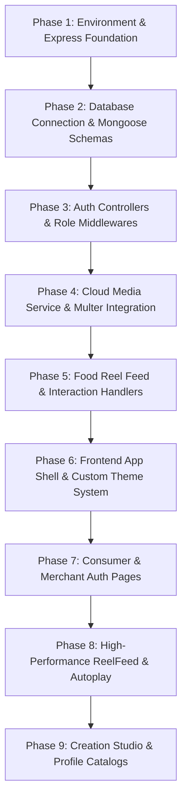

# Step 3: Rebuild Order From Scratch

This guide details the step-by-step engineering sequence for reconstructing the **Zomato Reel Feed** application from a blank directory. Building in this strict dependency order prevents circular references, broken endpoints, and missing context.

---

## Reconstruction Dependency Sequence



---

## Phase 1: Environment & Express Foundation

### Rationale
Before any data models or routes can be tested, the HTTP server must be initialized with CORS and CookieParser to handle credentialed JSON requests.

### Files Created
* `backend/package.json`
* `backend/.env`
* `backend/src/app.js`
* `backend/server.js`

### Key Code Snippet: `backend/src/app.js`
```javascript
const express = require('express');
const cookieParser = require('cookie-parser');
const cors = require('cors');

const app = express();

app.use(cors({
    origin: "http://localhost:5173",
    credentials: true
}));
app.use(cookieParser());
app.use(express.json());

module.exports = app;
```

#### Line-by-Line Explanation:
* **Lines 1–3:** Import the core Express framework, cookie-parsing middleware, and Cross-Origin Resource Sharing utility.
* **Line 5:** Initialize the Express application instance `app`.
* **Lines 7–10:** Configure CORS with `origin: "http://localhost:5173"` to whitelist the Vite React development server. `credentials: true` instructs Express to emit the `Access-Control-Allow-Credentials: true` header, allowing the browser to expose incoming `Set-Cookie` tokens to client scripts.
* **Line 11:** Invokes `cookieParser()` to parse incoming HTTP `Cookie` headers and populate `req.cookies`.
* **Line 12:** Mounts the built-in `express.json()` body parser to decode incoming JSON payloads into `req.body`.
* **Line 14:** Exports the configured `app` instance without binding to a port, allowing clean unit testing with Supertest.

---

## Phase 2: Database Connection & Data Schemas

### Rationale
Database persistence is prerequisite to user authentication and content publishing. The Mongoose connection must be established at startup, and schemas must enforce data constraints.

### Files Created
* `backend/src/db/db.js`
* `backend/src/models/user.model.js`
* `backend/src/models/foodpartner.model.js`
* `backend/src/models/food.model.js`
* `backend/src/models/likes.model.js`
* `backend/src/models/save.model.js`

### Key Code Snippet: `backend/src/models/food.model.js`
```javascript
const mongoose = require('mongoose');

const foodSchema = new mongoose.Schema({
    name: {
        type: String,
        required: true,
    },
    video: {
        type: String,
        required: true,
    },
    description: {
        type: String,
    },
    foodPartner: {
        type: mongoose.Schema.Types.ObjectId,
        ref: "foodpartner"
    },
    likeCount: {
        type: Number,
        default: 0
    },
    savesCount: {
        type: Number,
        default: 0
    }
});

const foodModel = mongoose.model("food", foodSchema);
module.exports = foodModel;
```

#### Line-by-Line Explanation:
* **Line 1:** Imports Mongoose ODM.
* **Lines 3–27:** Defines `foodSchema`.
* **Lines 4–11:** Declares required string fields `name` and `video` (holding the ImageKit CDN URL).
* **Lines 15–18:** Establishes a relational foreign key reference to the `foodpartner` collection using `mongoose.Schema.Types.ObjectId`.
* **Lines 19–26:** Declares integer counters `likeCount` and `savesCount` with default `0`. These denormalized counters avoid expensive aggregation operations on the `likes` and `saves` collections during high-traffic feed reads.
* **Line 29:** Compiles schema into model `food`.

---

## Phase 3: Dual-Role Authentication & Middlewares

### Rationale
Protected endpoints require signed tokens. Building auth controllers and verification middleware early allows testing secure routes with Postman or Curl.

### Files Created
* `backend/src/controllers/auth.controller.js`
* `backend/src/middlewares/auth.middleware.js`
* `backend/src/routes/auth.routes.js`

### Key Code Snippet: `backend/src/middlewares/auth.middleware.js`
```javascript
const userModel = require("../models/user.model");
const jwt = require("jsonwebtoken");

async function authUserMiddleware(req, res, next) {
    const token = req.cookies.token;

    if (!token) {
        return res.status(401).json({
            message: "Please login first"
        });
    }

    try {
        const decoded = jwt.verify(token, process.env.JWT_SECRET);
        const user = await userModel.findById(decoded.id);
        req.user = user;
        next();
    } catch (err) {
        return res.status(401).json({
            message: "Invalid token"
        });
    }
}
```

#### Line-by-Line Explanation:
* **Lines 1–2:** Import `userModel` and the `jsonwebtoken` library.
* **Line 4:** Define async Express middleware `authUserMiddleware`.
* **Line 5:** Extract the session token from `req.cookies.token`.
* **Lines 7–11:** If the cookie is absent, halt the request and respond with HTTP 401 Unauthorized.
* **Lines 13–19:** Pass the token to `jwt.verify` against `process.env.JWT_SECRET`. If verified, query MongoDB for the corresponding user and assign the document to `req.user`, then invoke `next()` to yield control to the route controller.
* **Lines 20–24:** If token verification fails (tampered, expired, or invalid secret), catch the exception and return HTTP 401.

---

## Phase 4: Cloud Media Service & Multer Integration

### Rationale
Video reels must be ingested, uploaded to ImageKit, and stored before the feed can display content.

### Files Created
* `backend/src/services/storage.service.js`
* `backend/src/routes/food.routes.js` (Multer setup)

### Key Code Snippet: `backend/src/services/storage.service.js`
```javascript
const ImageKit = require("imagekit");

const imagekit = new ImageKit({
    publicKey: process.env.IMAGEKIT_PUBLIC_KEY,
    privateKey: process.env.IMAGEKIT_PRIVATE_KEY,
    urlEndpoint: process.env.IMAGEKIT_URL_ENDPOINT
});

async function uploadFile(file, fileName) {
    const result = await imagekit.upload({
        file: file,
        fileName: fileName,
    });
    return result;
}

module.exports = { uploadFile };
```

#### Line-by-Line Explanation:
* **Line 1:** Imports ImageKit Node.js SDK.
* **Lines 3–7:** Instantiates the ImageKit client using credentials loaded from `process.env`.
* **Lines 9–15:** Declares `uploadFile` taking a binary `Buffer` (`file`) and string identifier `fileName` (UUID). It calls `imagekit.upload()`, which returns an object containing the secure CDN URL `result.url`.

---

## Phase 5: Food Feed, Likes & Bookmarks Controllers

### Rationale
Now that storage and authentication are operational, implement the endpoints that power reel playback, toggling likes, and saving dishes.

### Files Created
* `backend/src/controllers/food.controller.js`
* `backend/src/controllers/food-partner.controller.js`
* `backend/src/routes/food-partner.routes.js`

### Key Code Snippet: `backend/src/controllers/food.controller.js`
```javascript
async function likeFood(req, res) {
    const { foodId } = req.body;
    const user = req.user;

    const isAlreadyLiked = await likeModel.findOne({
        user: user._id,
        food: foodId
    });

    if (isAlreadyLiked) {
        await likeModel.deleteOne({ user: user._id, food: foodId });
        await foodModel.findByIdAndUpdate(foodId, { $inc: { likeCount: -1 } });
        return res.status(200).json({ message: "Food unliked successfully" });
    }

    const like = await likeModel.create({ user: user._id, food: foodId });
    await foodModel.findByIdAndUpdate(foodId, { $inc: { likeCount: 1 } });
    res.status(201).json({ message: "Food liked successfully", like });
}
```

#### Line-by-Line Explanation:
* **Lines 2–3:** Extract target `foodId` from body and authenticated consumer `user` from `req.user`.
* **Lines 5–8:** Check if a join record already exists in `likes`.
* **Lines 10–14:** If already liked, delete the like record and decrement the parent counter atomically using `$inc: { likeCount: -1 }`, returning 200.
* **Lines 16–18:** If not liked, insert the like record and atomically increment the parent counter using `$inc: { likeCount: 1 }`, returning 201.

---

## Phase 6: Frontend App Shell & Custom Theme System

### Rationale
Setting up the Vite React application, theme tokens, and routing structure first creates the container for all future views.

### Files Created
* `frontend/vite.config.js`
* `frontend/src/styles/theme.css`
* `frontend/src/styles/reels.css`
* `frontend/src/routes/AppRoutes.jsx`
* `frontend/src/App.jsx`
* `frontend/src/main.jsx`

---

## Phase 7: Consumer & Merchant Auth Pages

### Files Created
* `frontend/src/pages/auth/ChooseRegister.jsx`
* `frontend/src/pages/auth/UserRegister.jsx`
* `frontend/src/pages/auth/UserLogin.jsx`
* `frontend/src/pages/auth/FoodPartnerRegister.jsx`
* `frontend/src/pages/auth/FoodPartnerLogin.jsx`
* `frontend/src/styles/auth-shared.css`

---

## Phase 8: High-Performance ReelFeed & Autoplay

### Rationale
The core component of the app: virtualized IntersectionObserver autoplay loop.

### Files Created
* `frontend/src/components/ReelFeed.jsx`
* `frontend/src/components/BottomNav.jsx`
* `frontend/src/pages/general/Home.jsx`
* `frontend/src/pages/general/Saved.jsx`

### Key Code Snippet: `frontend/src/components/ReelFeed.jsx`
```javascript
useEffect(() => {
  const observer = new IntersectionObserver(
    (entries) => {
      entries.forEach((entry) => {
        const video = entry.target;
        if (!(video instanceof HTMLVideoElement)) return;
        if (entry.isIntersecting && entry.intersectionRatio >= 0.6) {
          video.play().catch(() => {});
        } else {
          video.pause();
        }
      });
    },
    { threshold: [0, 0.25, 0.6, 0.9, 1] }
  );

  videoRefs.current.forEach((vid) => observer.observe(vid));
  return () => observer.disconnect();
}, [items]);
```

#### Line-by-Line Explanation:
* **Line 1:** Attaches an effect that runs whenever the `items` array updates.
* **Lines 2–15:** Creates a browser `IntersectionObserver`.
* **Lines 6–7:** Guards type to ensure target is an HTML5 `<video>` element.
* **Lines 8–12:** When the element crosses a 60% intersection ratio (`intersectionRatio >= 0.6`), `.play()` is called. A `.catch()` handler suppresses browser autoplay permission rejections. When it leaves the 60% threshold, `.pause()` executes immediately.
* **Line 16:** Configures a multi-step threshold array `[0, 0.25, 0.6, 0.9, 1]` to capture granular visibility updates during fast scrolling.
* **Line 19:** Iterates through all video elements registered in `videoRefs.current` and attaches the observer.
* **Line 20:** Cleanup function calls `observer.disconnect()` on unmount or items change.

---

## Phase 9: Creation Studio & Profile Catalogs

### Files Created
* `frontend/src/pages/food-partner/CreateFood.jsx`
* `frontend/src/pages/food-partner/Profile.jsx`
* `frontend/src/styles/create-food.css`
* `frontend/src/styles/profile.css`
