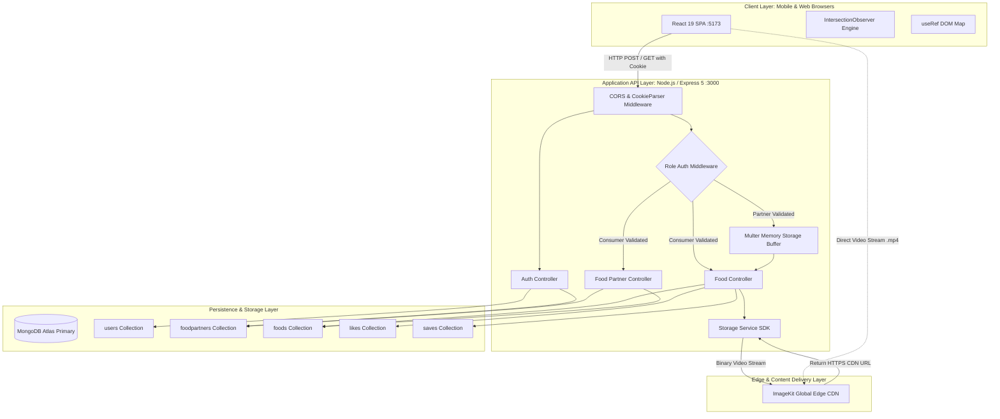
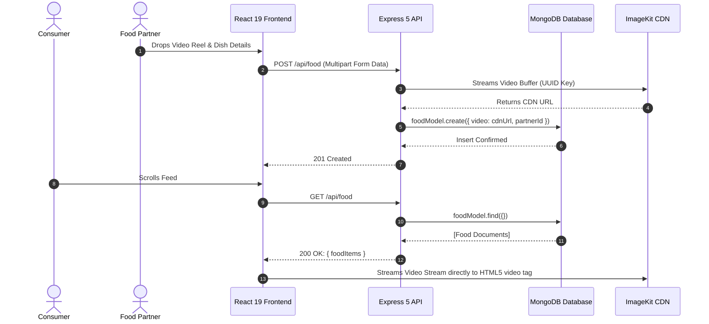
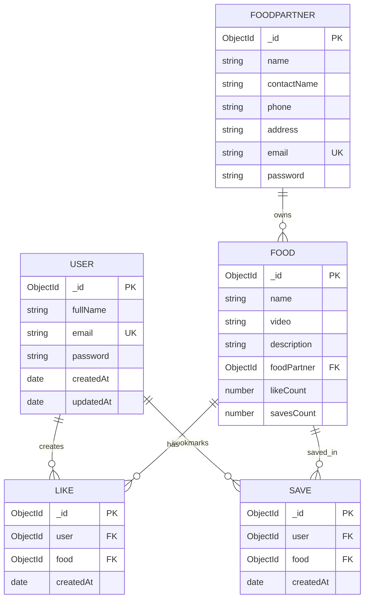
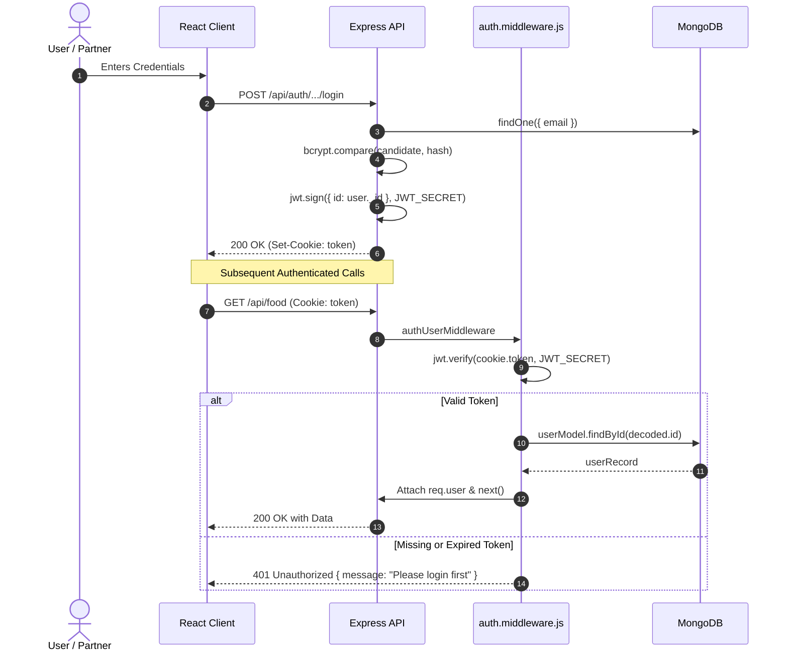

# Step 6: Architecture & System Design

This document details the architectural topology, request lifecycles, data flow models, database schema indexes, caching strategies, and 100x scaling considerations for **Zomato Reel Feed**.

---

## 1. High-Level Architecture

The platform implements a **decoupled Client-Server architecture** with a Single Page Application frontend communicating over REST/JSON to an Express 5 API layer, supported by MongoDB for transactional persistence and ImageKit for cloud media processing and CDN distribution.



---

## 2. Request Lifecycles (Top 3 Features)

### Lifecycle 1: Video Reel Discovery & Viewport Playback
1. **Client Mount:** Consumer loads `/`. `Home.jsx` triggers `axios.get("http://localhost:3000/api/food", { withCredentials: true })`.
2. **Gateway & Auth:** Express parses incoming cookie `token`. `authUserMiddleware` invokes `jwt.verify(token, JWT_SECRET)`. On signature validation, it fetches `userModel.findById(decoded.id)` and binds `req.user`.
3. **Database Fetch:** `foodController.getFoodItems` executes `foodModel.find({})`. MongoDB returns an array of food documents.
4. **DOM Mounting:** React renders `<ReelFeed items={videos} />`. `videoRefs` registers every `<video>` node in a Map without re-rendering.
5. **Autoplay Trigger:** `IntersectionObserver` fires when a video crosses `intersectionRatio >= 0.6`. Browser issues HTTP range requests directly to ImageKit CDN (`item.video`) and streams video chunks inline.

### Lifecycle 2: Merchant Video Reel Ingestion
1. **File Drop:** Merchant selects a video on `/create-food`. React invokes `URL.createObjectURL(videoFile)` for local hardware preview.
2. **Multipart Submission:** Partner submits form. Axios posts `FormData` containing dish `name`, `description`, and binary field `mama`.
3. **Role Enforcement:** `authFoodPartnerMiddleware` ensures the caller possesses a valid merchant JWT, loading `req.foodPartner`.
4. **RAM Buffering:** Multer intercepts the stream and writes the file into `req.file.buffer`.
5. **Cloud Dispatch:** `storageService.uploadFile` invokes ImageKit SDK with a generated UUID filename (`uuid()`). ImageKit ingests the buffer and returns a secure HTTPS CDN URL.
6. **Persistence:** `foodModel.create` inserts a new record into `foods` referencing `req.foodPartner._id`. Controller responds with HTTP 201.

### Lifecycle 3: Atomic Reel Like Toggle
1. **User Action:** Consumer taps heart icon on a reel. `Home.jsx` calls `POST /api/food/like` with `{ foodId }`.
2. **Auth Verification:** `authUserMiddleware` extracts user ID from verified JWT cookie.
3. **Join Check:** `foodController.likeFood` checks `likeModel.findOne({ user: user._id, food: foodId })`.
4. **Atomic Branching:**
   - **Branch A (Unlike):** Record found -> `likeModel.deleteOne()` followed by `foodModel.findByIdAndUpdate(foodId, { $inc: { likeCount: -1 } })`. Returns HTTP 200.
   - **Branch B (Like):** Record absent -> `likeModel.create()` followed by `foodModel.findByIdAndUpdate(foodId, { $inc: { likeCount: 1 } })`. Returns HTTP 201.
5. **Optimistic UI:** Client updates `likeCount` in state immediately.

---

## 3. Data Flow Diagram



---

## 4. Database Schema & Indexing Architecture



### Indexing Rationale & Audit

| Collection | Index Name | Fields | Type | Why This Index Exists |
|---|---|---|---|---|
| `users` | `email_1` | `{ email: 1 }` | Unique B-tree | Enforces login uniqueness and accelerates consumer credential lookups from $O(N)$ to $O(\log N)$. |
| `foodpartners` | `email_1` | `{ email: 1 }` | Unique B-tree | Enforces merchant email uniqueness and accelerates partner login queries. |
| `foods` | `_id_` | `{ _id: 1 }` | Primary Key B-tree | Default MongoDB primary key index for rapid food updates and counter increments. |
| `foods` | `foodPartner_1` | `{ foodPartner: 1 }` | Single field (Recommended) | **[Gaps to Add]:** Speeds up `Profile.jsx` queries fetching all dishes for a specific restaurant (`/api/food-partner/:id`). |
| `likes` | `user_1_food_1`| `{ user: 1, food: 1 }` | Compound Unique (Recommended) | **[Gaps to Add]:** Prevents duplicate likes at the database level and eliminates race conditions during rapid tapping. |
| `saves` | `user_1_food_1`| `{ user: 1, food: 1 }` | Compound Unique (Recommended) | **[Gaps to Add]:** Prevents duplicate bookmarks and speeds up `getSaveFood` lookups. |

---

## 5. Authentication & Authorization Flow



---

## 6. AI Integration Architecture (Production Upgrade Plan)

> **Current Reality:** **No AI integration implemented** in the existing codebase. 
> Below is the production-grade multimodal AI architecture designed to be integrated into this stack.

```mermaid
flowchart LR
    Upload[Partner Uploads Video Reel] --> NodeServer[Express API]
    NodeServer --> FrameExtractor[FFmpeg Video Frame Extractor]
    FrameExtractor --> GeminiVision[Google Gemini 1.5 Flash API]
    GeminiVision --> StructuredTags[JSON Dish Tags & Ingredients]
    StructuredTags --> VectorEmbed[text-embedding-004]
    VectorEmbed --> AtlasVector[(Atlas Vector Search Index)]
    AtlasVector --> RecEngine[Personalized Reel Recommendation Engine]
```



---

## 7. Caching Strategy & Multi-Tier Hierarchy

1. **Browser / Client Cache:**
   - HTML5 video elements stream with `preload="metadata"` and leverage browser byte-range caching (`206 Partial Content`).
2. **Edge CDN Cache (ImageKit):**
   - Transcoded MP4 videos are cached at edge POPs worldwide with `Cache-Control: public, max-age=31536000, immutable`.
3. **Application Cache (Redis - Recommended Upgrade):**
   - The global video feed (`GET /api/food`) currently executes a full database scan (`foodModel.find({})`). Under high traffic, this should be cached in Redis with a 60-second TTL using a Cache-Aside pattern:
     ```javascript
     const cachedFeed = await redis.get("feed:global");
     if (cachedFeed) return JSON.parse(cachedFeed);
     const feed = await foodModel.find({});
     await redis.setex("feed:global", 60, JSON.stringify(feed));
     ```

---

## 8. Scaling to 100x Traffic: The First 3 Bottlenecks

### Bottleneck 1: Node.js Memory Heap Starvation from Multer Uploads
* **The Problem:** Currently, Multer buffers the entire video in server RAM (`multer.memoryStorage()`). If 50 partners simultaneously upload 100MB videos, the Node.js process consumes 5GB of RAM, triggering an instant V8 heap crash (Out-Of-Memory).
* **The Solution:** Implement client-side presigned upload URLs. The client requests a presigned signature from Express, then uploads the video directly from the browser to ImageKit/S3, completely bypassing the Node.js application server.

### Bottleneck 2: Monolithic Database Table Scans on `foodModel.find({})`
* **The Problem:** The main feed endpoint performs an unindexed, unpaginated `find({})` across the entire `foods` collection. At 100,000 reels, this query exceeds memory thresholds and crashes MongoDB.
* **The Solution:** Implement cursor-based infinite pagination using `_id` or `createdAt` (`find({ _id: { $lt: lastSeenId } }).limit(10)`), backed by a compound index on `{ createdAt: -1, _id: -1 }`.

### Bottleneck 3: Raw MP4 Delivery vs Adaptive Bitrate Streaming (HLS)
* **The Problem:** The application currently streams raw MP4 files. Mobile users on 3G/4G connections will experience severe video buffering, high latency, and massive data usage.
* **The Solution:** Introduce asynchronous video transcoding pipelines that convert uploaded MP4s into multi-bitrate HLS streams (`.m3u8` playlists with 360p, 720p, and 1080p chunks), served via global edge CDN.
