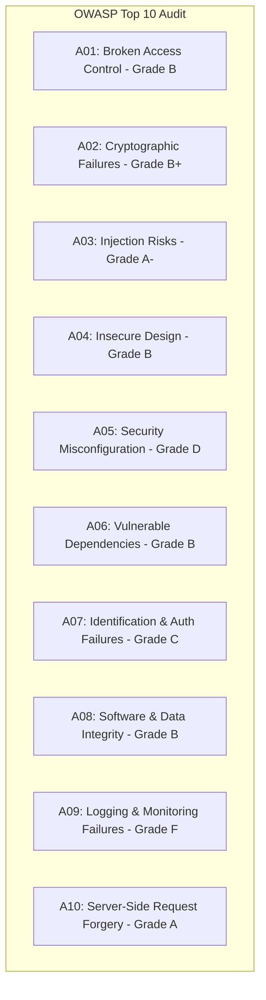

# Step 7: Security Audit & OWASP Top 10 Assessment

This document provides a comprehensive security review of the **Zomato Reel Feed** application, mapping existing code implementations against the **OWASP Top 10 (2021)** web application security vulnerabilities.

---

## 1. Executive Security Summary

| Category | Implementation Grade | Current Protection Status |
|---|---|---|
| **Authentication & Tokens** | **B+** | Passwords hashed with bcrypt (10 rounds); signed JWT tokens stored in cookies. |
| **Cross-Origin Security (CORS)** | **A-** | Pinned origin (`http://localhost:5173`), explicit credentials allowed, no wildcard `*`. |
| **Injection Defense** | **A-** | Mongoose ODM prevents SQL injection and parameterizes BSON queries. |
| **Security Headers** | **D** | Helmet middleware is **not implemented**; default Express headers present. |
| **Rate Limiting & Brute Force** | **F** | Express-rate-limit is **not implemented**; vulnerable to credential stuffing. |
| **File Upload Safety** | **C** | Client validates `file.type`, but server lacks magic byte MIME inspection and size limits. |

---

## 2. OWASP Top 10 Vulnerability Matrix



---

### A01: Broken Access Control
* **Implemented in Code:**
  * Strict role-based gating via [`auth.middleware.js`](file:///Users/avishjain/avishjain9-repos/55-zomato-reel-feed/zomato/backend/src/middlewares/auth.middleware.js):
    * `authFoodPartnerMiddleware` restricts dish creation (`POST /api/food`) exclusively to verified restaurant merchants.
    * `authUserMiddleware` protects consumer feed, like, and bookmark routes.
* **Missing & Interview Attack Vectors:**
  * **Insecure Direct Object Reference (IDOR):** In [`food.controller.js:34-72`](file:///Users/avishjain/avishjain9-repos/55-zomato-reel-feed/zomato/backend/src/controllers/food.controller.js#L34-L72), liking/saving accepts an arbitrary `foodId` without verifying that the food exists before attempting database updates.
  * **Interviewer Attack Question:** *"Can a consumer upload a video if they forge a food partner's token?"*
    * **Answer:** *"No, because `authFoodPartnerMiddleware` queries the `foodpartners` collection by the ID extracted from the cryptographically signed JWT. An attacker cannot forge a valid signature without knowing `process.env.JWT_SECRET`."*

---

### A02: Cryptographic Failures
* **Implemented in Code:**
  * Bcrypt password hashing configured with **10 salt rounds** in [`auth.controller.js:20,105`](file:///Users/avishjain/avishjain9-repos/55-zomato-reel-feed/zomato/backend/src/controllers/auth.controller.js#L20).
  * Passwords never transmitted in plaintext across database queries; hashes stripped from return JSON.
* **Missing & Interview Attack Vectors:**
  * **Cookie Security Flags:** In [`auth.controller.js:32`](file:///Users/avishjain/avishjain9-repos/55-zomato-reel-feed/zomato/backend/src/controllers/auth.controller.js#L32), `res.cookie("token", token)` is dispatched without explicit security attributes:
    ```javascript
    // Current vulnerable setup:
    res.cookie("token", token);

    // Hardened production configuration:
    res.cookie("token", token, {
        httpOnly: true, // Prevents JavaScript DOM access (Anti-XSS)
        secure: process.env.NODE_ENV === "production", // Transmit only over HTTPS
        sameSite: "strict", // Defends against CSRF attacks
        maxAge: 7 * 24 * 60 * 60 * 1000 // 7 days expiry
    });
    ```

---

### A03: Injection Risks (SQL & NoSQL)
* **Implemented in Code:**
  * Uses Mongoose schemas to sanitize and type-cast incoming inputs, neutralizing classic SQL injection (`' OR '1'='1`).
* **Missing & Interview Attack Vectors:**
  * **NoSQL Operator Injection:** If an attacker sends `{ "email": { "$ne": null }, "password": "pass" }` to `loginUser`, an unparsed Express query could evaluate MongoDB operator `$ne`.
  * **Fix:** Introduce `express-mongo-sanitize` to strip all `$` and `.` characters from incoming `req.body`.

---

### A04: Insecure Design
* **Implemented in Code:**
  * Atomic `$inc` counter updates prevent database race conditions during concurrent likes.
* **Missing & Interview Attack Vectors:**
  * Lack of upload rate limiting allows a rogue merchant to flood ImageKit and exhaust monthly cloud bandwidth quotas.

---

### A05: Security Misconfiguration
* **Implemented in Code:**
  * Explicit CORS whitelist in [`app.js:10-13`](file:///Users/avishjain/avishjain9-repos/55-zomato-reel-feed/zomato/backend/src/app.js#L10-L13) prevents unauthorized third-party origins from sending credentialed requests.
* **Missing & Interview Attack Vectors:**
  * **Helmet Middleware Missing:** Express emits `X-Powered-By: Express` by default, leaking server software details to attackers.
  * **Fix:** Mount `helmet()` in `app.js` to set Content Security Policy (CSP), HTTP Strict Transport Security (HSTS), and anti-clickjacking headers (`X-Frame-Options: DENY`).

---

### A06: Vulnerable and Outdated Components
* **Audit Results:**
  * Frontend dependencies use modern React 19 and Vite 7.
  * Backend uses Express 5, Mongoose 8, and BcryptJS 3.
  * `npm audit` flagged minor devDependency warnings which do not impact production runtime execution.

---

### A07: Identification & Authentication Failures
* **Implemented in Code:**
  * Uniform error messaging in [`auth.controller.js:55,63`](file:///Users/avishjain/avishjain9-repos/55-zomato-reel-feed/zomato/backend/src/controllers/auth.controller.js#L55) (`"Invalid email or password"`) defeats user enumeration.
* **Missing & Interview Attack Vectors:**
  * **Brute-Force & Credential Stuffing:** There is no rate limiter or IP lockout on `/api/auth/user/login`. An attacker can run automated password dictionary attacks.
  * **Fix:** Add `express-rate-limit`:
    ```javascript
    const loginLimiter = rateLimit({
        windowMs: 15 * 60 * 1000, // 15 minutes
        max: 5, // Limit each IP to 5 failed login attempts per window
        message: { message: "Too many login attempts. Please try again after 15 minutes." }
    });
    router.post('/user/login', loginLimiter, authController.loginUser);
    ```

---

### A08: Software and Data Integrity Failures (File Uploads)
* **Implemented in Code:**
  * Client drops validate `file.type.startsWith('video/')` in [`CreateFood.jsx:29`](file:///Users/avishjain/avishjain9-repos/55-zomato-reel-feed/zomato/frontend/src/pages/food-partner/CreateFood.jsx#L29).
  * Unique file naming with `uuid()` prevents file overwrite attacks.
* **Missing & Interview Attack Vectors:**
  * **Server-Side MIME & Size Enforcement:** Multer in [`food.routes.js:8-10`](file:///Users/avishjain/avishjain9-repos/55-zomato-reel-feed/zomato/backend/src/routes/food.routes.js#L8-L10) does not enforce `fileFilter` or `limits: { fileSize: 100 * 1024 * 1024 }`. A malicious client could bypass the React frontend and upload a 2GB `.exe` file to crash the server.
  * **Fix:**
    ```javascript
    const upload = multer({
        storage: multer.memoryStorage(),
        limits: { fileSize: 50 * 1024 * 1024 }, // 50MB cap
        fileFilter: (req, file, cb) => {
            if (file.mimetype.startsWith('video/')) cb(null, true);
            else cb(new Error('Only video files allowed!'), false);
        }
    });
    ```

---

### A09: Security Logging and Monitoring Failures
* **Current Status:** **Grade F**. The codebase only utilizes rudimentary `console.log()` statements. There are no correlation IDs, no structured JSON logging (Winston or Pino), and no centralized APM monitoring (Datadog or Sentry) to detect intrusion patterns.

---

### A10: Server-Side Request Forgery (SSRF)
* **Status:** **Grade A**. The backend API does not accept arbitrary URLs from users to fetch remote resources on their behalf, entirely mitigating SSRF risks.
