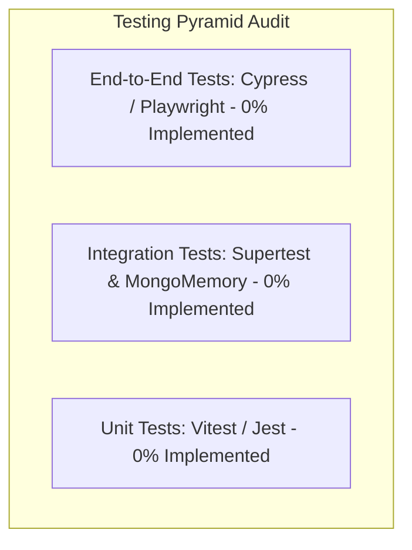

# Step 9: Engineering Quality & Operations

This document reviews testing coverage, static code analysis, continuous integration/deployment (CI/CD), logging infrastructure, runtime bottlenecks, and technical debt in **Zomato Reel Feed**.

---

## 1. Testing Status & Test Pyramid Audit



### Current Status
* **Present Tests:** None. `package.json` in both backend and root declares `"test": "echo \"Error: no test specified\" && exit 1"`.
* **Missing Test Suites:**
  1. **Unit Tests:** Password hashing, JWT token generation and verification, Multer buffer processing, IntersectionObserver state transitions.
  2. **Integration Tests:** Supertest endpoint testing on `/api/auth/*` and `/api/food/*` with an in-memory database (`mongodb-memory-server`).
  3. **End-to-End (E2E) Tests:** Playwright or Cypress tests verifying full user journeys: registration -> reel scroll -> like toggle -> visit store profile.

---

## 2. Linting & Code Standards

* **Frontend:** ESLint 9 configured via [`zomato/frontend/eslint.config.js`](file:///Users/avishjain/avishjain9-repos/55-zomato-reel-feed/zomato/frontend/eslint.config.js):
  * Employs `@eslint/js` recommendations.
  * Enforces `eslint-plugin-react-hooks` (`rules-of-hooks`, `exhaustive-deps`) and `eslint-plugin-react-refresh`.
* **Backend:** Currently lacks ESLint or Prettier configurations; formatting is maintained manually using standard CommonJS idioms.

---

## 3. Git Workflow & Version Control Evidence

* **Repository:** Monorepo containing `backend/`, `frontend/`, and `vdeos/`.
* **Git History:** Clean commit log initializing the MERN backend architecture (`b60d39f: Initial upload of MERN Zomato Backend`).
* **Branching Strategy (Recommended):** Feature-branch workflow (`main` protected, PR reviews required, squashed merges).

---

## 4. Logging & Observability

### Current Implementation
* Elementary `console.log()` statements placed in server startup (`server.js:9`), database connection (`db.js:8,11`), and controllers.

### Production Roadmap: Structured Logging with Pino
```javascript
// Recommended backend logger (src/utils/logger.js)
const pino = require('pino');
const logger = pino({
    level: process.env.LOG_LEVEL || 'info',
    timestamp: pino.stdTimeFunctions.isoTime,
    redact: ['req.headers.cookie', 'password'] // Masks sensitive data
});
module.exports = logger;
```

---

## 5. Deployment Setup & Containerization

### Dockerfile for Express Backend
```dockerfile
# Multi-stage lightweight Node container
FROM node:22-alpine AS builder
WORKDIR /app
COPY zomato/backend/package*.json ./
RUN npm ci --only=production
COPY zomato/backend/ ./

FROM node:22-alpine
WORKDIR /app
COPY --from=builder /app ./
EXPOSE 3000
USER node
CMD ["node", "server.js"]
```

### Docker Compose Local Architecture
```yaml
version: '3.8'
services:
  backend:
    build:
      context: .
      dockerfile: zomato/backend/Dockerfile
    ports:
      - "3000:3000"
    environment:
      - PORT=3000
      - MONGODB_URI=mongodb://mongo:27017/zomato-reels
      - JWT_SECRET=supersecretlocaldevkey
    depends_on:
      - mongo

  frontend:
    build:
      context: ./zomato/frontend
    ports:
      - "5173:5173"

  mongo:
    image: mongo:7.0
    ports:
      - "27017:27017"
    volumes:
      - mongo_data:/data/db

volumes:
  mongo_data:
```

---

## 6. Performance Bottlenecks Detected in Code

1. **Multer Memory Buffering (`food.routes.js:9`):**
   * Storing uncompressed video files in Node.js RAM can trigger process OOM crashes under concurrent uploads.
2. **Unpaginated Reel Feed (`food.controller.js:26`):**
   * Calling `foodModel.find({})` pulls all documents into memory simultaneously, causing linear query degradation ($O(N)$).
3. **No Database Indexes on Foreign Keys (`foods.foodPartner`):**
   * Pulling a partner's dish catalog performs a full collection scan on `foods`.

---

## 7. Concurrency & Race Condition Risks

* **Rapid Like/Save Tapping:**
  * If a user double-clicks the like button rapidly, two simultaneous `POST /api/food/like` requests can pass `likeModel.findOne()` before either inserts, creating duplicate like documents.
  * **Remedy:** Apply a compound unique index on `{ user: 1, food: 1 }` in both `likes.model.js` and `save.model.js`.

---

## 8. Technical Debt Knowingly Taken

1. **Hardcoded API URLs:** Frontend files explicitly query `http://localhost:3000` rather than using `import.meta.env.VITE_API_BASE_URL`.
2. **Missing Cookie Expiry:** Authentication cookies are session-bound and do not declare `maxAge` or `expires`.
3. **Missing Error Boundary in React:** Uncaught rendering exceptions can unmount the entire client component tree.
