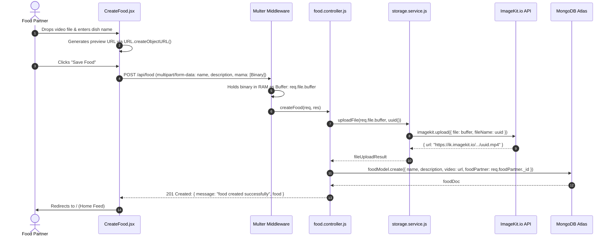

# Feature Group 4: Food Reel Creation & Cloud Media Ingestion (F11)

This section covers the restaurant partner content publishing pipeline: drag-and-drop video file selection, in-browser blob preview, multipart form streaming, Multer memory storage, and ImageKit CDN ingestion.

---

## F11: Food Video Upload & Cloud Storage via ImageKit CDN

### Overview & User-Facing Behavior
Allows authenticated food partners to publish culinary video reels on `/create-food`. The partner can drag and drop or select an MP4/WebM video file (up to ~100MB), instantly watch an in-browser local preview, supply a dish name and description, and upload the reel to ImageKit's global media CDN.

### Files and Functions Involved
* [`zomato/frontend/src/pages/food-partner/CreateFood.jsx`](file:///Users/avishjain/avishjain9-repos/55-zomato-reel-feed/zomato/frontend/src/pages/food-partner/CreateFood.jsx):
  * `onFileChange(e)` ([lines 26–32](file:///Users/avishjain/avishjain9-repos/55-zomato-reel-feed/zomato/frontend/src/pages/food-partner/CreateFood.jsx#L26-L32)): Validates `file.type.startsWith('video/')` from input change.
  * `onDrop(e)` ([lines 34–42](file:///Users/avishjain/avishjain9-repos/55-zomato-reel-feed/zomato/frontend/src/pages/food-partner/CreateFood.jsx#L34-L42)): Intercepts drag-and-drop file drops.
  * `useEffect` preview ([lines 16–24](file:///Users/avishjain/avishjain9-repos/55-zomato-reel-feed/zomato/frontend/src/pages/food-partner/CreateFood.jsx#L16-L24)): Generates object URL via `URL.createObjectURL(videoFile)` and revokes it on cleanup.
  * `onSubmit(e)` ([lines 50–67](file:///Users/avishjain/avishjain9-repos/55-zomato-reel-feed/zomato/frontend/src/pages/food-partner/CreateFood.jsx#L50-L67)): Bundles `name`, `description`, and `videoFile` into a `FormData` object with field name `"mama"`, then calls Axios POST.
* [`zomato/backend/src/routes/food.routes.js:8-17`](file:///Users/avishjain/avishjain9-repos/55-zomato-reel-feed/zomato/backend/src/routes/food.routes.js#L8-L17):
  * Configures Multer: `const upload = multer({ storage: multer.memoryStorage() })`.
  * Binds route: `router.post('/', authMiddleware.authFoodPartnerMiddleware, upload.single("mama"), foodController.createFood)`.
* [`zomato/backend/src/controllers/food.controller.js:8-23`](file:///Users/avishjain/avishjain9-repos/55-zomato-reel-feed/zomato/backend/src/controllers/food.controller.js#L8-L23): `createFood`.
* [`zomato/backend/src/services/storage.service.js:9-16`](file:///Users/avishjain/avishjain9-repos/55-zomato-reel-feed/zomato/backend/src/services/storage.service.js#L9-L16): `uploadFile(file, fileName)` calls `imagekit.upload(...)`.
* [`zomato/backend/src/models/food.model.js:3-30`](file:///Users/avishjain/avishjain9-repos/55-zomato-reel-feed/zomato/backend/src/models/food.model.js#L3-L30): Schema mapping `name`, `video`, `description`, `foodPartner` ref, and counters.

### Detailed Technical Execution Steps

### Architecture Decisions & Trade-Offs

#### 1. Why Multer Memory Storage vs Disk Storage?
* **Choice:** `multer.memoryStorage()`.
* **Reason:** Containerized environments (like Docker containers deployed on AWS ECS, Render, or Railway) have ephemeral, read-only or resource-constrained local filesystems. Writing large video files to the container disk risks running out of storage space and requires complex background file cleanup routines. Storing the buffer in memory allows immediate piping to ImageKit.
* **Trade-off:** RAM consumption. If multiple food partners concurrently upload 100MB files, the Node.js process heap can spike and trigger an Out-Of-Memory (OOM) crash. In production, this is solved by using presigned S3/ImageKit client-side uploads.

#### 2. Why ImageKit over AWS S3?
* **Choice:** ImageKit.io.
* **Reason:** ImageKit includes a pre-configured global CDN out of the box and natively supports on-the-fly media transformations and optimization parameters (e.g. video quality compression, thumbnail extraction) without having to configure AWS CloudFront, Lambda@Edge, and AWS MediaConvert.

### Say It Out Loud (Spoken Interview Script)
> "The media ingestion pipeline in `CreateFood.jsx` is one of the most critical parts of the application.
> 
> When a restaurant partner wants to showcase a dish, they drag a short video file onto our custom dropzone. To deliver an instant, zero-latency user experience, my React code uses `URL.createObjectURL(videoFile)` to mount an immediate video preview element in the browser before any byte touches the network.
> 
> When the partner clicks 'Save Food', the client bundles the video binary, title, and description into a `FormData` object and dispatches it with credentials to `/api/food`.
> 
> On our Express server, the request first passes through `authFoodPartnerMiddleware` to confirm that the requester is a verified food partner. It then hits Multer, configured with `memoryStorage()`, which buffers the incoming video directly into `req.file.buffer`.
> 
> From there, my controller calls `storageService.uploadFile()`, passing the raw buffer and a cryptographically unique UUID generated with the `uuid` package to prevent file collisions. 
> 
> ImageKit processes the video, stores it on their media cloud, and returns a secure CDN URL. Finally, my controller writes a new document to the `foods` collection in MongoDB, linking the CDN URL with the merchant's `_id`, and returns a 201 status to redirect the partner to the live feed.
> 
> An alternative I evaluated was storing files directly on the server's local disk. I rejected local disk storage because serverless and containerized hosts have ephemeral filesystems that wipe upon restart, and holding large video files on disk makes horizontal autoscaling impossible.
> 
> The trade-off I accepted with memory buffers is Node.js heap usage during concurrent uploads. For a 100x traffic surge, I would upgrade this flow to use direct client-side presigned upload URLs so large video binaries bypass our Node API servers entirely."
