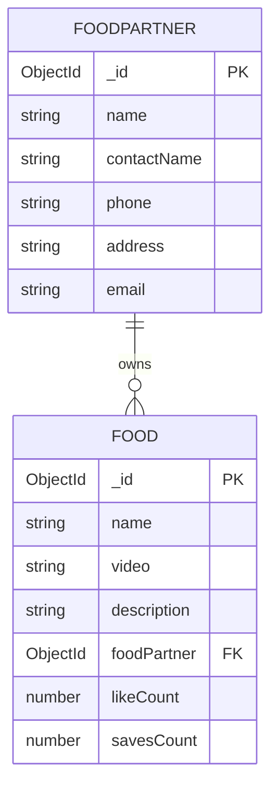

# Feature Group 5: Food Partner Public Profile & Menu Catalog (F12)

This section covers the merchant store page, detailing how consumers navigate from an engaging video reel to inspect a restaurant's physical address, operational stats, and complete video catalog.

---

## F12: Food Partner Public Profile & Video Grid Catalog

### Overview & User-Facing Behavior
When a consumer taps "Visit store" on any food reel in the main feed, they are navigated to `/food-partner/:id`. The screen presents:
1. Restaurant profile header: Avatar image, business name pill, and physical address pill.
2. Operational metrics pills: "Total meals" and "Customers served".
3. A responsive 3-column video grid showcasing all culinary videos published by this food partner.

### Files and Functions Involved
* [`zomato/frontend/src/pages/food-partner/Profile.jsx`](file:///Users/avishjain/avishjain9-repos/55-zomato-reel-feed/zomato/frontend/src/pages/food-partner/Profile.jsx):
  * `useParams()` ([line 7](file:///Users/avishjain/avishjain9-repos/55-zomato-reel-feed/zomato/frontend/src/pages/food-partner/Profile.jsx#L7)): Extracts the restaurant ID from the URL.
  * `useEffect` ([lines 11–18](file:///Users/avishjain/avishjain9-repos/55-zomato-reel-feed/zomato/frontend/src/pages/food-partner/Profile.jsx#L11-L18)): Makes authenticated GET request to `/api/food-partner/${id}` whenever `:id` updates.
  * Grid rendering ([lines 51–65](file:///Users/avishjain/avishjain9-repos/55-zomato-reel-feed/zomato/frontend/src/pages/food-partner/Profile.jsx#L51-L65)): Maps `videos` into video tiles with `object-fit: cover`.
* [`zomato/backend/src/routes/food-partner.routes.js:8-11`](file:///Users/avishjain/avishjain9-repos/55-zomato-reel-feed/zomato/backend/src/routes/food-partner.routes.js#L8-L11):
  * Route binding: `router.get('/:id', authMiddleware.authUserMiddleware, foodPartnerController.getFoodPartnerById)`.
* [`zomato/backend/src/controllers/food-partner.controller.js:4-23`](file:///Users/avishjain/avishjain9-repos/55-zomato-reel-feed/zomato/backend/src/controllers/food-partner.controller.js#L4-L23):
  * `getFoodPartnerById(req, res)`: Queries `foodPartnerModel.findById` and `foodModel.find({ foodPartner: foodPartnerId })`.

### Functions Called in Execution
1. `foodPartnerModel.findById(foodPartnerId)`:
   * **Parameters:** MongoDB ObjectId string extracted from `req.params.id`.
   * **Return Value:** Merchant partner document or `null`.
2. `foodModel.find({ foodPartner: foodPartnerId })`:
   * **Parameters:** Query object filtering `foodPartner` foreign key.
   * **Return Value:** Array of all food documents published by this merchant.
3. `foodPartner.toObject()`:
   * **Purpose:** Converts Mongoose document into a plain JavaScript object so the controller can cleanly merge `foodItems` into the response payload.

### Data & Schema Mapping

### Say It Out Loud (Spoken Interview Script)
> "To connect dish discovery with actual restaurant orders, I built the merchant profile feature in `Profile.jsx` and `food-partner.controller.js`.
> 
> When a consumer taps 'Visit store' on any reel overlay, React Router navigates them to `/food-partner/:id`. The component reads the restaurant ID from the URL and dispatches a GET request to `/api/food-partner/:id`.
> 
> On the backend, `getFoodPartnerById` performs two queries: first, it fetches the merchant document from `foodpartners` to get the store's verified business name and physical address; second, it queries our `foods` collection where `foodPartner` matches the ID to pull their entire dish catalog.
> 
> If the partner doesn't exist, I return a 404 immediately. Otherwise, I convert the Mongoose document to a plain object, attach the food items array, and send back a 200 payload.
> 
> On the frontend, I render a clean header displaying their address and operational badges, followed by an Instagram-style three-column video grid of their uploaded reels.
> 
> One optimization I would make for higher scale is indexing the `foodPartner` foreign key on the `foods` collection and adding pagination so restaurants with hundreds of dishes don't dump their entire catalog in a single unindexed query."
