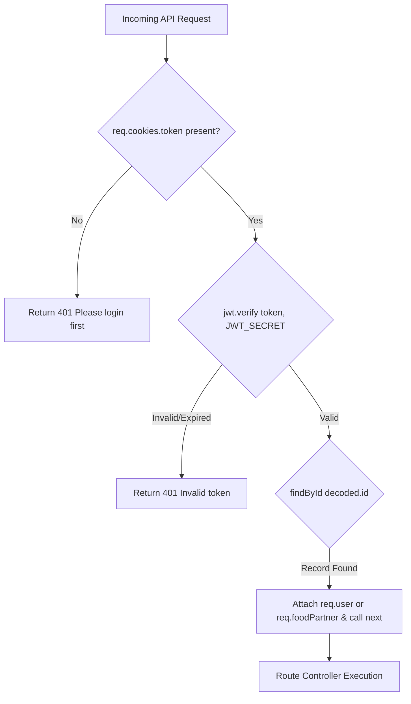

# Feature Group 6: Infrastructure & Shared Middlewares (F13 – F15)

This section details foundational application infrastructure: client-side multi-role navigation, cross-origin resource sharing with credentialed cookies, and dual-role JWT verification middlewares.

---

## F13: Navigation & Multi-Role Route Switching

### Overview & User-Facing Behavior
Provides persistent mobile bottom navigation and role-aware routing throughout the single-page application.
1. **Bottom Navigation Bar (`BottomNav.jsx`):** Renders fixed icon tabs at the bottom of the screen linking to the Home feed (`/`) and Saved bookmarks (`/saved`). Dynamically highlights the active tab.
2. **Registration Chooser (`ChooseRegister.jsx`):** Offers a decision gateway allowing users to proceed as a regular foodie or as a food partner.

### Files and Functions Involved
* [`zomato/frontend/src/components/BottomNav.jsx:9-29`](file:///Users/avishjain/avishjain9-repos/55-zomato-reel-feed/zomato/frontend/src/components/BottomNav.jsx#L9-L29):
  ```jsx
  <NavLink to="/" end className={({ isActive }) => `bottom-nav__item ${isActive ? 'is-active' : ''}`}>
    ...
  </NavLink>
  ```
* [`zomato/frontend/src/pages/auth/ChooseRegister.jsx`](file:///Users/avishjain/avishjain9-repos/55-zomato-reel-feed/zomato/frontend/src/pages/auth/ChooseRegister.jsx).
* [`zomato/frontend/src/routes/AppRoutes.jsx:17-27`](file:///Users/avishjain/avishjain9-repos/55-zomato-reel-feed/zomato/frontend/src/routes/AppRoutes.jsx#L17-L27): Route tree definition.

### Say It Out Loud (Spoken Interview Script)
> "To provide an app-like mobile experience in the browser, I designed `BottomNav.jsx` using React Router's `NavLink` component.
> 
> The component uses function-as-children class evaluation to dynamically apply the `.is-active` state based on URL matching, giving users an immediate visual cue whether they are on the discovery feed or their bookmarked collection.
> 
> In `AppRoutes.jsx`, I cleanly separated general consumer screens from merchant onboarding paths, providing an intuitive onboarding gateway in `ChooseRegister.jsx`."

---

## F14: Cross-Origin Resource Sharing (CORS) with Credentials

### Overview & User-Facing Behavior
Enables the React frontend (running on Vite at `http://localhost:5173`) to make authenticated HTTP requests to the Express API (running on `http://localhost:3000`) without being blocked by browser Same-Origin Policy (SOP).

### Files and Functions Involved
* [`zomato/backend/src/app.js:10-13`](file:///Users/avishjain/avishjain9-repos/55-zomato-reel-feed/zomato/backend/src/app.js#L10-L13):
  ```javascript
  app.use(cors({
      origin: "http://localhost:5173",
      credentials: true
  }));
  ```
* [`zomato/frontend/src/pages/auth/UserLogin.jsx:19`](file:///Users/avishjain/avishjain9-repos/55-zomato-reel-feed/zomato/frontend/src/pages/auth/UserLogin.jsx#L19), [`Home.jsx:11`](file:///Users/avishjain/avishjain9-repos/55-zomato-reel-feed/zomato/frontend/src/pages/general/Home.jsx#L11), etc.:
  ```javascript
  axios.get("http://localhost:3000/api/food", { withCredentials: true })
  ```

### Why Both Sides Must Declare Credentials
Under modern browser specifications (W3C CORS), cross-origin cookies will **never** be transmitted or accepted unless two conditions are met simultaneously:
1. The client must explicitly send `withCredentials: true` in the XMLHttpRequest or Fetch/Axios config.
2. The server must respond with `Access-Control-Allow-Credentials: true` and **must not** use a wildcard `*` for `Access-Control-Allow-Origin`. In our backend, `origin: "http://localhost:5173"` explicitly pins the allowed origin.

### Say It Out Loud (Spoken Interview Script)
> "Because our client and API run on separate ports during development—5173 and 3000—browsers trigger strict Cross-Origin Resource Sharing security checks.
> 
> By default, browsers refuse to send or accept cookies across different origins. To solve this, I configured the `cors` package in `app.js` with `origin: 'http://localhost:5173'` and `credentials: true`.
> 
> On the frontend, every Axios call includes `{ withCredentials: true }`. This dual configuration ensures that our signed JWT session cookies travel safely back and forth without wildcard vulnerabilities."

---

## F15: Protected Route Middlewares (Consumer & Partner Gates)

### Overview & User-Facing Behavior
Guards private API endpoints against unauthorized access, enforcing strict role isolation so that standard consumers cannot upload dishes and unauthenticated callers cannot fetch user data.

### Files and Functions Involved
* [`zomato/backend/src/middlewares/auth.middleware.js`](file:///Users/avishjain/avishjain9-repos/55-zomato-reel-feed/zomato/backend/src/middlewares/auth.middleware.js):
  * `authFoodPartnerMiddleware(req, res, next)` ([lines 6–33](file:///Users/avishjain/avishjain9-repos/55-zomato-reel-feed/zomato/backend/src/middlewares/auth.middleware.js#L6-L33)): Verifies JWT against `process.env.JWT_SECRET`, loads `foodPartnerModel.findById(decoded.id)`, and attaches the partner to `req.foodPartner`.
  * `authUserMiddleware(req, res, next)` ([lines 35–62](file:///Users/avishjain/avishjain9-repos/55-zomato-reel-feed/zomato/backend/src/middlewares/auth.middleware.js#L35-L62)): Verifies JWT, loads `userModel.findById(decoded.id)`, and attaches the consumer to `req.user`.



### Say It Out Loud (Spoken Interview Script)
> "To enforce security and role-based access control, I created two custom Express middlewares in `auth.middleware.js`: `authUserMiddleware` and `authFoodPartnerMiddleware`.
> 
> When a request hits a protected route, the middleware inspects `req.cookies.token`. If the cookie is missing, it immediately rejects the call with a 401 'Please login first'.
> 
> If present, it passes the token through `jwt.verify` wrapped in a try/catch block. If the token is signed with our secret, it extracts the decoded ID and queries the respective collection—`users` or `foodpartners`—attaching the full entity to the request object before calling `next()`.
> 
> This guarantees that downstream controllers like `createFood` have instant, verified access to `req.foodPartner._id` without writing repetitive authentication code in every handler."
