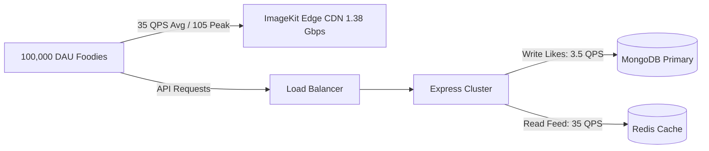

# 14.1 System Design: Requirements & Capacity Estimation

---

## 1. What It Is in Plain Words
Requirements definition specifies what the system must do (functional) and how well it must do it (non-functional). Capacity estimation is the back-of-the-envelope arithmetic used to calculate throughput (Queries Per Second), disk storage accumulation, network bandwidth, and memory footprints before writing code.

---

## 2. Whether and How THIS Project Uses It
* **Functional Requirements:**
  1. Consumers must stream vertical culinary reels with low latency.
  2. Consumers must be able to like, bookmark, and view bookmarked reels.
  3. Consumers must be able to visit a restaurant's profile and view their dish catalog.
  4. Restaurant partners must be able to upload MP4/WebM videos with titles and descriptions.
  5. Both consumers and partners must authenticate securely via separate roles.
* **Non-Functional Requirements:**
  1. **Latency:** Under 200ms API response time; under 500ms time-to-first-frame for video playback.
  2. **High Availability:** 99.9% uptime for consumer feeds.
  3. **Data Integrity:** Like and save counters must remain accurate under concurrent load.

---

## 3. Capacity Estimation Math (Show the Arithmetic)

### Traffic Estimation (Current MVP vs 100x Production Scale)

#### Scale Assumptions:
* **Daily Active Users (DAU):** $100,000$ active foodies.
* **Daily Active Partners:** $1,000$ active restaurants.
* **Average Reels Watched per User:** $30$ reels per day.
* **Total Daily Video Views:** $100,000 \times 30 = 3,000,000$ reel views/day.

#### Queries Per Second (QPS) Calculations:
$$\text{Seconds per Day} = 86,400 \approx 100,000 \text{ seconds (for conservative estimates)}$$
$$\text{Feed Read QPS} = \frac{3,000,000 \text{ views}}{86,400 \text{ seconds}} \approx 35 \text{ requests/sec}$$
$$\text{Peak Feed QPS (Factor of } 3\text{)} = 35 \times 3 \approx 105 \text{ requests/sec}$$

#### Engagement Actions (Likes & Saves):
* Like Rate: $10\%$ of watched reels $\rightarrow 300,000$ likes/day $\rightarrow \approx 3.5$ writes/sec (Peak: $\approx 10$ writes/sec).
* Save Rate: $2\%$ of watched reels $\rightarrow 60,000$ saves/day $\rightarrow \approx 0.7$ writes/sec.
* **Read-to-Write Ratio:** $3,000,000 : 360,000 \approx \mathbf{8.3 : 1}$ (Strongly Read-Heavy).

#### Storage Growth Estimation:
* New videos uploaded per day: $1,000 \text{ partners} \times 2 \text{ videos/day} = 2,000 \text{ uploads/day}$.
* Average compressed video size: $5 \text{ MB}$.
* Daily Video Storage: $2,000 \times 5 \text{ MB} = 10,000 \text{ MB} = \mathbf{10 \text{ GB / day}}$.
* Annual Video Storage: $10 \text{ GB} \times 365 = \mathbf{3.65 \text{ TB / year}}$.
* Metadata Storage (MongoDB): $2,000 \text{ foods/day} \times 1 \text{ KB} = 2 \text{ MB / day} \approx \mathbf{730 \text{ MB / year}}$.

#### Network Bandwidth Estimation:
* Outgoing Video Bandwidth: $3,000,000 \text{ views/day} \times 5 \text{ MB} = 15,000,000 \text{ MB/day} = 15 \text{ TB / day}$.
$$\text{Average Outgoing Bandwidth} = \frac{15 \text{ TB} \times 8 \text{ bits}}{86,400 \text{ seconds}} \approx \mathbf{1.38 \text{ Gbps}}$$
* **Key Insight:** Video streaming bandwidth will account for $>95\%$ of infrastructure costs, proving that offloading streaming to a CDN (ImageKit) is essential.

---

## 4. Full Alternatives Comparison Table

| Capacity Estimation Strategy | Precision | Setup Cost | Iteration Speed | Fit With Startups | Fit With Enterprise |
|---|---|---|---|---|---|
| **Back-of-Envelope Math (Chosen)** | Approximate (Order of Magnitude) | **Zero** | **Instant** | **10/10** | **9/10** |
| **Synthetic Load Testing (k6/Artillery)** | High | Moderate | Hours | 7/10 | 10/10 |
| **Production Shadowing (Traffic Mirroring)**| Exact | Very High | Weeks | 2/10 | 10/10 |

---

## 5. Trade-Offs Accepted
* In the current MVP stage, capacity estimations are theoretical approximations based on standard industry consumer metrics rather than live telemetry from production load balancers.

---

## 6. What Breaks at 10x, 100x, 1000x Load
* **At 10x (1,000 QPS):** MongoDB read latency on `foodModel.find({})` increases from 12ms to 350ms; requires Redis caching.
* **At 100x (10,000 QPS):** Node.js server RAM crashes from Multer memory buffers; requires client presigned uploads.
* **At 1000x (100,000 QPS):** MongoDB primary node reaches write connection saturation on likes; requires sharding by `foodId` and write-behind asynchronous batching.

---

## 7. How a Senior Engineer Would Improve It
* Automate continuous synthetic load tests in CI/CD using k6, testing endpoint degradation under simulated 5,000 concurrent virtual users.

---

## 8. Mermaid Architectural Flow Diagram

---

## 9. 30-Second Spoken Answer
> "At 100,000 daily active users watching 30 reels a day, our system handles approximately 35 queries per second on the feed and around 3.5 writes per second for likes, giving us an 8-to-1 read-heavy ratio. 
> 
> The dominant bottleneck is bandwidth: streaming 3 million 5MB reels generates 15 terabytes of traffic per day, or roughly 1.4 gigabits per second. Offloading video delivery to ImageKit's edge CDN prevents our Node.js API servers from saturating their network interfaces."
