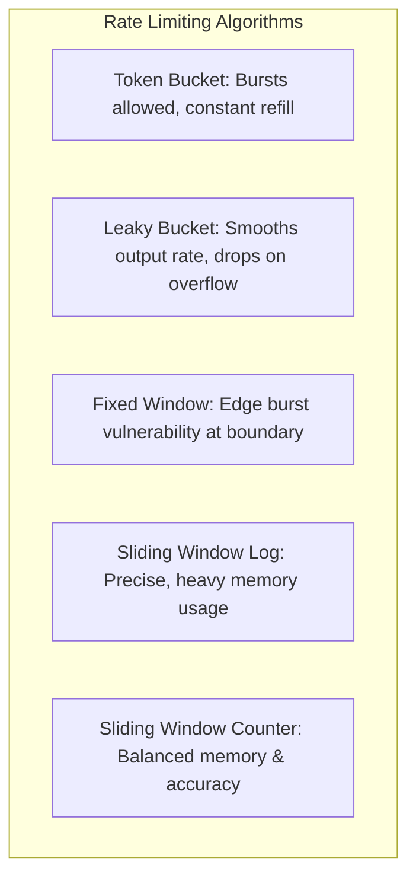

# 14.10 System Design: API Design, Pagination & Rate Limiting

---

## 1. What It Is in Plain Words
API design defines the protocols, versioning schemes, pagination techniques, and traffic policing mechanisms (rate limiting, throttling, and quotas) that keep an API reliable, predictable, and protected against abuse.

---

## 2. Whether and How THIS Project Uses It
* **Current API Design:** Standard REST resource endpoints mounted under `/api/auth`, `/api/food`, and `/api/food-partner`.
* **Current Pagination:** **Not implemented**. Feed fetches call `foodModel.find({})`, retrieving all documents simultaneously.
* **Current Rate Limiting:** **Not implemented**. Endpoints accept unrestricted requests.

---

## 3. Pagination Styles Compared: Offset vs Cursor

| Pagination Approach | Performance at Page 1 | Performance at Page 1,000 | Consistency Under Real-Time Inserts | URL Query Example | Fit With Reel Feed |
|---|---|---|---|---|---|
| **Offset-Based (`skip` & `limit`)** | Fast | **Severe Degradation ($O(N)$ scan)** | **Poor (Skipped or duplicate items)** | `?page=50&limit=10` | 2/10 (Breaks infinite video feed) |
| **Cursor-Based (`$lt` on `_id`) (Chosen)**| **Fast ($O(\log N)$)**| **Fast ($O(\log N)$ indexed jump)**| **Rock Solid (Stable pagination)** | `?cursor=673f8a9e...&limit=10`| **10/10 (Industry standard for Reels)** |

```mermaid
flowchart LR
    subgraph OffsetPagination [Offset: MongoDB scans all preceding rows]
        Skip[db.foods.find().skip(100000).limit(10)]
        Disk[Exhausts memory & disk reads]
    end

    subgraph CursorPagination [Cursor: Direct B-tree index seek]
        Seek[db.foods.find({ _id: { $lt: cursor } }).limit(10)]
        Direct[Immediate O(log N) index seek]
    end
```

---

## 4. Rate Limiting Algorithms Compared



| Algorithm | Handles Bursts? | Memory Footprint | Precision | Recommended Use in Project |
|---|---|---|---|---|
| **Token Bucket** | **Yes** | Low (Integer counter + timestamp) | High | General API Gateway protection |
| **Leaky Bucket** | No (Smooths traffic) | Low | High | Video upload ingestion throttling |
| **Fixed Window** | Yes (Double burst at window edge) | **Minimal** | Low | Low-priority internal jobs |
| **Sliding Window Counter (Chosen)**| **Yes** | **Low (Current + Prev window weights)**| **High** | **Auth endpoints & like toggling** |

### Production Sliding Window Counter Implementation (Redis)
$$\text{Weight} = \frac{\text{Time Left in Current Window}}{\text{Window Size}}$$
$$\text{Estimated Requests} = (\text{Previous Window Count} \times \text{Weight}) + \text{Current Window Count}$$

---

## 5. What Breaks at 10x, 100x, 1000x Load
* **10x:** Scraping bots exhaust database connection pools; fixed by adding IP-based sliding window rate limits (100 req/min).
* **100x:** Unpaginated feed calls crash MongoDB memory; fixed by enforcing mandatory cursor pagination (`limit: 10`).
* **1000x:** Distributed botnets bypass IP rate limits; fixed by deploying Cloudflare Bot Management with Web Application Firewall (WAF) device fingerprinting.

---

## 6. 30-Second Spoken Answer
> "For an infinite vertical video feed, offset pagination with `.skip()` is a major anti-pattern because it degrades to O(N) database scans and causes duplicate items as new videos are uploaded. 
> 
> We implement cursor-based pagination using the MongoDB `_id` B-tree index, providing O(log N) lookups regardless of feed depth. To protect against denial of service, we enforce sliding window rate limiting in Redis, allowing smooth traffic bursts while blocking credential brute-forcing."
