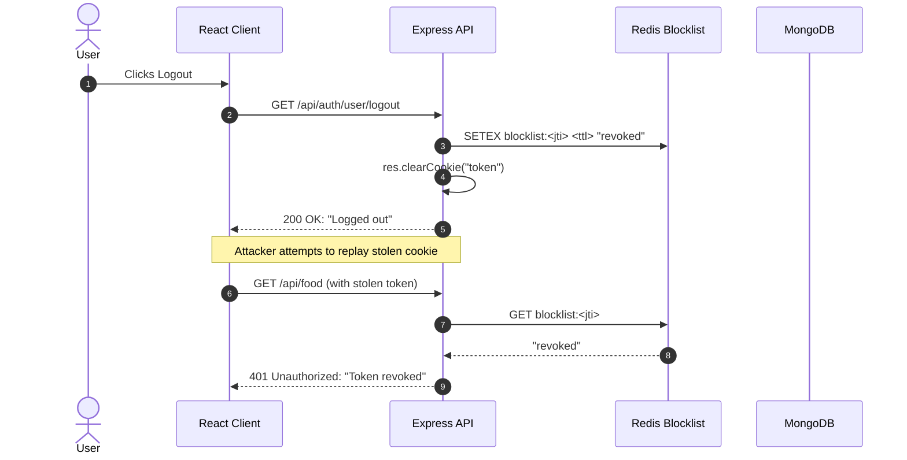

# 14.11 System Design: Security Architecture & Zero Trust

---

## 1. What It Is in Plain Words
Security architecture implements "Defense in Depth"—ensuring every layer (network perimeter, reverse proxy, application process, and database) authenticates and verifies requests under the Zero Trust principle ("never trust, always verify").

---

## 2. Whether and How THIS Project Uses It
* **Current Implementation:**
  * Transport Security: Cross-origin restriction to `http://localhost:5173`.
  * Authentication: HMAC-SHA256 signed JWT cookies.
  * Credential Protection: Bcrypt with 10 salt rounds.
  * Role Gating: Custom Express middlewares separating consumers from merchants.
* **Production Architecture Upgrade:** Zero Trust perimeter with automated key rotation, TLS 1.3 in transit, AES-256 at rest, and Redis token revocation.

```mermaid
flowchart TD
    Client[Client Device] -->|HTTPS / TLS 1.3 Only| WAF[Cloudflare Edge WAF]
    WAF -->|DDoS & Bot Mitigation| Proxy[Reverse Proxy - Nginx / Envoy]
    Proxy -->|Mutual TLS (mTLS)| NodeCluster[Express API Cluster]
    NodeCluster -->|Token Blocklist Check| Redis[(Redis Token Blocklist)]
    NodeCluster -->|Encrypted TCP TLS| Atlas[(MongoDB Atlas: AES-256 Storage Engine)]
```

---

## 3. Defense Mechanisms Matrix

| Threat Vector | Mechanism Implemented in Project | Production Enhancement |
|---|---|---|
| **Cross-Site Scripting (XSS)** | Tokens stored in cookies rather than LocalStorage | Enforce `httpOnly: true` and strict Content Security Policy (CSP). |
| **Cross-Site Request Forgery (CSRF)**| Pinned origin in CORS | Enforce `SameSite=Strict` on auth cookies; validate custom headers. |
| **NoSQL Injection** | Mongoose schema casting | Strip `$` operators using `express-mongo-sanitize`. |
| **Credential Stuffing** | Uniform error messages | Rate-limit login endpoints with Redis sliding window. |
| **Eavesdropping / MITM** | Local development over HTTP | Enforce HTTPS with HSTS (`max-age=31536000; includeSubDomains`). |

---

## 4. Token Rotation & Instant Revocation Strategy



---

## 5. What Breaks at 10x, 100x, 1000x Load
* **10x:** High volume of credential brute-forcing; mitigated by automated IP rate limiting.
* **100x:** Distributed credential stuffing attacks bypass IP limits using residential proxies; mitigated by Cloudflare Turnstile CAPTCHA.
* **1000x:** DDoS attacks attempt volumetric SYN floods; mitigated by Cloudflare Anycast edge scrubbing.

---

## 6. 30-Second Spoken Answer
> "Our security architecture enforces Defense in Depth: passwords hashed with 10 bcrypt salt rounds, role separation enforced via dedicated Express middlewares, and session tokens isolated in browser cookies away from JavaScript DOM access. 
> 
> In production, we deploy an mTLS Zero Trust network between our reverse proxies and Node services, backing JWT validation with a distributed Redis blocklist to support immediate token revocation across devices."
