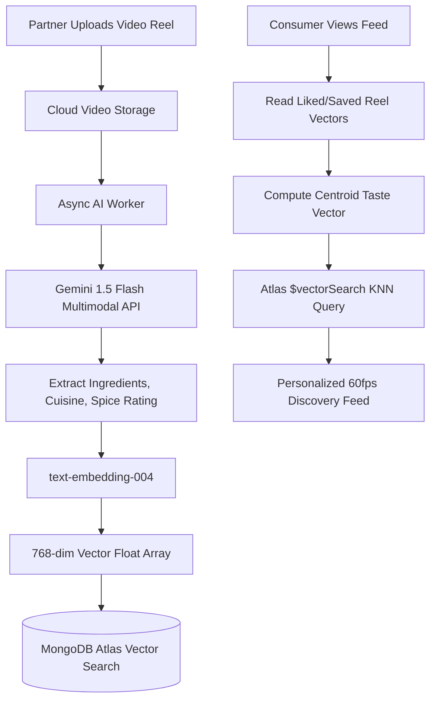

# 14.12 System Design: Search & AI Recommendation Systems

---

## 1. What It Is in Plain Words
Search and recommendation architectures combine inverted text index engines (for keyword queries like *"paneer tikka"*) with vector embeddings and machine learning similarity algorithms (for semantic recommendations like *"spicy appetizers similar to what I watched last night"*).

---

## 2. Whether and How THIS Project Uses It
* **Current Status:** The current codebase utilizes direct MongoDB read queries (`foodModel.find({})`) with no full-text search indexes and no active AI integrations.
* **Production Architecture Upgrade:** A hybrid search engine pairing MongoDB text indexing with **MongoDB Atlas Vector Search** powered by **Google Gemini 1.5 Flash** embeddings.

---

## 3. Search Engine Alternatives Compared

| Search Engine | Query Type | Latency | Infrastructure Overhead | Typo Tolerance | Cost | Fit With MERN Stack |
|---|---|---|---|---|---|---|
| **MongoDB Text Index (Phase 1)** | Keyword / Lexical | Moderate (~25ms) | **Zero (Native in MongoDB)** | None | **Free** | **9/10 (Best initial step)** |
| **Atlas Vector Search (Phase 2)** | Semantic / Multimodal | Fast (~15ms) | **Zero (Built into Atlas)** | High (Vector distance) | Moderate | **10/10 (Unified database & vectors)** |
| **Elasticsearch / OpenSearch** | BM25 + Lucene + Vector | Fast (~10ms) | Very High (Dedicated JVM cluster)| High | High | 6/10 (High operational complexity) |
| **Algolia** | Hosted Keyword & Typo | Ultra-Fast (<5ms) | Zero (SaaS) | Extreme | Very High (Per-search billing) | 7/10 |
| **Meilisearch** | Fast Rust Inverted Index | Ultra-Fast (<5ms) | Moderate (Self-hosted binary) | High | Low | 8/10 |

---

## 4. End-to-End Multimodal Recommendation Pipeline

### Recommendation Math: Vector Centroid Calculation
When a user likes $k$ reels with vectors $\vec{v}_1, \vec{v}_2, \dots, \vec{v}_k$, their personal taste vector $\vec{u}$ is the normalized centroid:
$$\vec{u} = \frac{\frac{1}{k} \sum_{i=1}^k \vec{v}_i}{\left\| \frac{1}{k} \sum_{i=1}^k \vec{v}_i \right\|}$$
This vector $\vec{u}$ is queried against Atlas Vector Search using **Cosine Similarity**:
$$\text{Sim}(\vec{u}, \vec{v}_{\text{dish}}) = \vec{u} \cdot \vec{v}_{\text{dish}}$$

---

## 5. What Breaks at 10x, 100x, 1000x Load
* **10x:** Text queries slow down during prefix searches; resolved by creating compound text indexes on `{ name: 'text', description: 'text' }`.
* **100x:** Vector similarity queries consume excessive Atlas RAM; resolved by deploying dedicated vector search index nodes with Hierarchical Navigable Small World (HNSW) indexing.
* **1000x:** Real-time embedding generation latency exceeds SLOs; resolved by precomputing offline recommendations in batch using Apache Spark or Databricks.

---

## 6. 30-Second Spoken Answer
> "We design our search and discovery engine around a hybrid model: MongoDB text indexes handle exact restaurant and dish keyword queries, while MongoDB Atlas Vector Search powers our personalized recommendation feed. 
> 
> We generate 768-dimensional embeddings using Google's text-embedding-004 model based on ingredients extracted by Gemini 1.5 Flash, matching consumers with similar dishes via cosine distance without the complexity of managing an external vector database."
