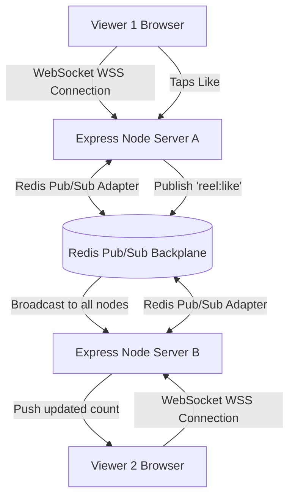

# 14.13 System Design: Real-Time Protocols & WebSockets

---

## 1. What It Is in Plain Words
Real-time architecture enables bidirectional or server-initiated push communication between the client and server with sub-100ms latency, powering live view counts, real-time comment streams, and instant order notifications.

---

## 2. Whether and How THIS Project Uses It
* **Current Status:** In the active codebase, real-time push is **not implemented**. The client relies on standard HTTP request-response pulls (fetching the feed once on mount in [`Home.jsx:10`](file:///Users/avishjain/avishjain9-repos/55-zomato-reel-feed/zomato/frontend/src/pages/general/Home.jsx#L10) and updating like counts via individual HTTP POST responses).
* **Production Architecture Upgrade:** WebSockets via **Socket.io** backed by a **Redis Pub/Sub** message broker to broadcast live engagement tickers.

---

## 3. Real-Time Transport Protocols Compared

| Protocol | Directionality | Multiplexing | Browser Support | Reconnection Support | Firewall / Proxy Traversal | Fit With Reel Feed |
|---|---|---|---|---|---|---|
| **WebSockets (Socket.io) (Recommended)** | **Full-Duplex (Bidirectional)**| **Yes (Rooms/Namespaces)**| Universal | **Built-in (Heartbeats)** | High (Upgrades HTTP) | **10/10 (Live likes, comments, chats)** |
| **Server-Sent Events (SSE)** | Unidirectional (Server -> Client)| Yes (HTTP/2) | Universal (except IE) | Native browser auto-retry | High (Standard HTTP) | 8/10 (Great for read-only ticker) |
| **Short Polling (Current)** | Unidirectional (Client pulls) | No | Universal | Manual | Universal | 3/10 (Wastes server resources) |
| **Long Polling** | Unidirectional | No | Universal | High server socket hold | Moderate | 4/10 (Outdated) |

---

## 4. Scaling WebSockets: The Redis Pub/Sub Backplane
* **The Problem:** In a multi-server cluster, User A is connected to Node 1 via WebSocket, while User B is connected to Node 2. When User A likes a reel, Node 1 does not have an open socket to User B.
* **The Solution:** Mount `@socket.io/redis-adapter`. When Node 1 receives a like, it publishes a message to Redis channel `reel:<id>:likes`. Redis instantly broadcasts the event to all server nodes, which emit the new count to their locally connected socket clients.

---

## 5. What Breaks at 10x, 100x, 1000x Load
* **10x:** Single server runs out of file descriptors (default OS limit 1,024 sockets); resolved by tuning `ulimit -n 65535`.
* **100x:** Node process RAM exhausted by open socket state; resolved by scaling horizontally across 10 container nodes.
* **1000x:** Redis Pub/Sub single-core bandwidth saturates; resolved by partitioning channels across Redis Cluster shards or deploying managed services like AWS API Gateway WebSockets.

---

## 6. 30-Second Spoken Answer
> "While our prototype uses standard REST calls, our production system design integrates WebSockets via Socket.io to push real-time like counts and comments. 
> 
> To scale across multiple stateless Node instances, we connect our WebSocket servers through a Redis Pub/Sub backplane. When an interaction occurs on any server, Redis broadcasts the event to all nodes, keeping thousands of concurrent reel viewers synchronized with sub-50ms latency."
