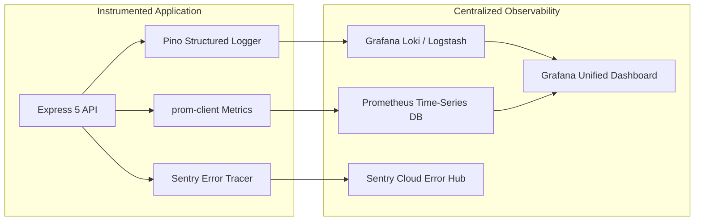

# 14.14 System Design: Observability, Monitoring & Operations

---

## 1. What It Is in Plain Words
Observability provides full visibility into the internal health, performance, and failure modes of a distributed system by aggregating the Three Pillars: structured logs (what happened), time-series metrics (how the system is performing), and distributed traces (where time was spent across services).

---

## 2. Whether and How THIS Project Uses It
* **Current Status:** Basic `console.log()` statements in controllers and server initialization.
* **Production Architecture Upgrade:**
  1. **Structured Logs:** Pino emitting ndjson format with correlation IDs.
  2. **Metrics:** Prometheus client scraping `/metrics` (HTTP latency, QPS, error rates, memory).
  3. **Error Tracking:** Sentry SDK intercepting client and server exceptions.
  4. **Dashboards:** Grafana visualizing p95/p99 latency and active video streams.

---

## 3. The Three Pillars of Observability Detailed

### 1. Structured Logging with Correlation IDs
Every incoming request receives an `X-Correlation-ID` header. This ID is attached to every downstream log, database query, and external API call, allowing engineers to trace a user's entire request journey through millions of log lines.

### 2. Time-Series Metrics (The Golden Signals)
* **Latency:** Time taken to service feed requests (measured at p50, p95, p99).
* **Traffic:** Requests per second (QPS) routed through the API.
* **Errors:** Rate of HTTP 5xx server errors and 4xx client errors.
* **Saturation:** How "full" the system is (CPU usage, RAM allocation, database connection pool utilization).

### 3. Distributed Tracing (OpenTelemetry)
Spans capture timing across individual hops: Express router $\rightarrow$ auth middleware $\rightarrow$ MongoDB query $\rightarrow$ ImageKit API.

---

## 4. Deployment Strategies Compared

| Deployment Strategy | Downtime | Rollback Speed | Cloud Cost | Blast Radius | Recommended Use |
|---|---|---|---|---|---|
| **Recreate (Kill & Start)** | High | Slow | Lowest | 100% of users | Local dev only |
| **Rolling Deploy (Chosen)** | **Zero** | Fast (5–10 min) | **Low (Over-provision +25%)** | Moderate (Subset of traffic) | **Standard production releases** |
| **Blue-Green Deploy** | Zero | **Instant (Router flip)**| High (2x infrastructure cost) | High | Critical database/schema upgrades |
| **Canary Deploy** | Zero | Instant | Moderate | **Minimal (1% to 10% traffic first)** | High-risk AI & video features |

---

## 5. What Breaks at 10x, 100x, 1000x Load
* **10x:** `console.log` synchronous string serialization blocks Node.js event loop; fixed by using asynchronous Pino logger.
* **100x:** Logging volume overwhelms local disk; fixed by streaming logs via Fluentbit to Grafana Loki or AWS CloudWatch.
* **1000x:** Storing 100% of distributed traces becomes cost-prohibitive; fixed by implementing tail-based trace sampling (recording only errors and p99 slow requests).

---

## 6. 30-Second Spoken Answer
> "We design observability around the Three Pillars: Pino structured JSON logging with correlation IDs, Prometheus scraping the Four Golden Signals (Latency, Traffic, Errors, Saturation), and Sentry for real-time exception tracking. 
> 
> In production, we deploy zero-downtime rolling updates on Kubernetes, paired with automated alerts in Grafana that trigger PagerDuty notifications whenever p95 feed latency exceeds our 250ms SLO."
