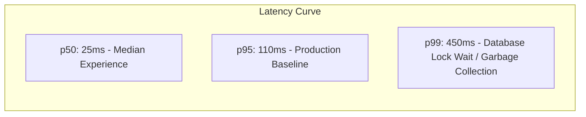

# 14.15 System Design: Performance Engineering & Profiling

---

## 1. What It Is in Plain Words
Performance engineering is the systematic measurement, analysis, and optimization of latency (response speed), throughput (capacity), resource efficiency (CPU/memory), and frontend rendering smoothness (60 frames per second, Core Web Vitals).

---

## 2. Whether and How THIS Project Uses It
* **Current Frontend Optimizations:**
  1. **IntersectionObserver Autoplay:** Only plays the single video with $\ge 60\%$ viewport visibility; pauses offscreen videos.
  2. **Ref-Based Element Management:** Holds video DOM elements in `useRef(new Map())` in [`ReelFeed.jsx:11`](file:///Users/avishjain/avishjain9-repos/55-zomato-reel-feed/zomato/frontend/src/components/ReelFeed.jsx#L11), preventing component re-renders during fast scrolling.
  3. **Zero-Overhead CSS Theming:** Native CSS Custom Properties in [`theme.css`](file:///Users/avishjain/avishjain9-repos/55-zomato-reel-feed/zomato/frontend/src/styles/theme.css) eliminate runtime JavaScript CSS-in-JS recalculations.

---

## 3. Latency Percentiles & Little's Law

### Understanding Percentiles
* **p50 (Median):** 50% of requests complete faster than this value.
* **p95:** 95% of requests complete faster; standard engineering baseline.
* **p99 (Long Tail):** 99% of requests complete faster; reveals outlier latency (e.g. cold starts, database lock stalls).

### Little's Law Applied to Reel Feed
$$L = \lambda \times W$$
* $\lambda$ (Arrival Rate) = $1,000 \text{ requests / second}$.
* $W$ (Average Latency) = $0.05 \text{ seconds (50ms)}$.
* $L$ (Concurrent Requests in System) = $1,000 \times 0.05 = \mathbf{50 \text{ concurrent in-flight requests}}$.
* **Takeaway:** If latency doubles to $100\text{ms}$, the system must sustain $100$ concurrent in-flight requests, requiring double the open connection sockets.

---

## 4. Core Web Vitals (CWV) Optimization

| Metric | Target | How Optimized in Project | Risk if Neglected |
|---|---|---|---|
| **Largest Contentful Paint (LCP)** | $< 2.5\text{s}$ | ImageKit CDN edge caching; `preload="metadata"` | High initial drop-off on slow mobile connections |
| **Interaction to Next Paint (INP)** | $< 200\text{ms}$ | Optimistic state updates on like/save; `useRef` Map | UI lag and button unresponsive feel |
| **Cumulative Layout Shift (CLS)** | $< 0.1$ | Fixed 100vh reel containers; explicit aspect ratio containers | Disorienting visual jumps during scrolling |

---

## 5. What Breaks at 10x, 100x, 1000x Load
* **10x:** Full bundle downloaded on first load slows initial page render; resolved by dynamic code splitting in Vite (`React.lazy(() => import('./CreateFood'))`).
* **100x:** Node.js V8 garbage collection cycles freeze API event loop for 100ms; resolved by reusing Buffer allocations and avoiding object churn.
* **1000x:** Video decoding on low-end Android hardware crashes mobile browser tabs; resolved by lowering default video resolution from 1080p to 720p on mobile devices.

---

## 6. 30-Second Spoken Answer
> "We approach performance from both ends: on the backend, we optimize latency by keeping our services stateless and utilizing atomic operators with Little's Law capacity planning. 
> 
> On the frontend, we guarantee smooth 60fps scrolling by decoupling the IntersectionObserver from React state using mutable refs, ensuring that scrolling never triggers virtual DOM re-renders while keeping Cumulative Layout Shift near zero."
