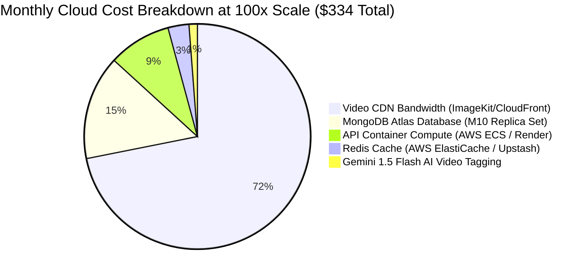

# 14.16 System Design: Cloud Economics, Costs & Trade-Offs

---

## 1. What It Is in Plain Words
Cloud economics and cost engineering balances infrastructure expenses (servers, bandwidth, database instances, AI API tokens) against engineering development velocity and operational maintenance overhead.

---

## 2. Monthly Cost Model: Current MVP vs 100x Production Scale

### Detailed Cost Accounting

| Infrastructure Tier | Current MVP (100 DAU) | 100x Scale (100,000 DAU) | Cost Driver & Pricing Basis |
|---|---|---|---|
| **API Compute (Express)** | **$0.00** (Local / Render Free Tier) | **$30.00 / month** | 3 $\times$ 1 vCPU / 2GB RAM container instances ($10/mo each) |
| **Database (MongoDB Atlas)**| **$0.00** (M0 Free Cluster 512MB) | **$50.00 / month** | Atlas M10 Replica Set with 10GB storage & automated daily snapshots |
| **Media CDN (ImageKit.io)** | **$0.00** (Free Tier: 20GB bandwidth) | **$240.00 / month** | ~3 TB CDN egress @ $0.08 / GB (Dominant cost driver) |
| **Application Cache (Redis)**| **$0.00** (None) | **$10.00 / month** | Upstash serverless or AWS t4g.micro ElastiCache |
| **AI Tagging (Gemini Flash)**| **$0.00** (Not implemented) | **$4.00 / month** | ~2,000 video uploads/day $\times$ $0.002 / min |
| **DNS & Security (Cloudflare)**| **$0.00** (Free Plan) | **$0.00 - $20.00 / mo** | Cloudflare Pro plan with automated WAF and image optimization |
| **TOTAL ESTIMATED SPEND** | **$0.00 / month** | **~$334.00 / month** | Less than $0.0035 per Daily Active User! |

---

## 3. Build vs Buy Decisions

| Capability | Decision | Alternative Evaluated | Deciding Factor |
|---|---|---|---|
| **Media CDN & Transcoding**| **Buy (ImageKit.io)** | Build (AWS S3 + CloudFront + FFmpeg) | Building custom transcoding requires weeks of video infrastructure engineering; ImageKit works in 5 lines of code. |
| **Authentication System** | **Build (Bcrypt + JWT)** | Buy (Clerk / Auth0) | Auth0 charges $35+/month for basic multi-role logins; built-in JWT gives complete control with zero vendor fees. |
| **Database Hosting** | **Buy (MongoDB Atlas)** | Build (Self-hosted Mongo EC2) | Self-hosting requires manual backup scripts, sharding maintenance, and failover management; Atlas handles high availability automatically. |

---

## 4. Vendor Lock-In & Exit Strategy
* **ImageKit Lock-In:** Mitigated because stored videos are referenced as plain HTTPS URLs (`item.video`). If ImageKit raises prices, media can be mirrored to an AWS S3 bucket and CloudFront distribution by simply changing the storage service upload target without altering database schemas or frontend players.
* **MongoDB Lock-In:** Mitigated by using standard Mongoose ODM abstractions. Migrating to DocumentDB or PostgreSQL with JSONB requires refactoring Mongoose models to an ORM like Prisma without changing frontend contracts.

---

## 5. 30-Second Spoken Answer
> "Our current MVP operates at zero monthly infrastructure cost by taking advantage of developer free tiers across Render, MongoDB Atlas, and ImageKit. 
> 
> At 100,000 daily active users, our projected cloud spend scales to approximately $334 per month, with video CDN bandwidth accounting for over 70% of the total cost. By choosing ImageKit over building custom video transcoding pipelines, we saved weeks of engineering time while keeping our unit economics below half a cent per active user."
