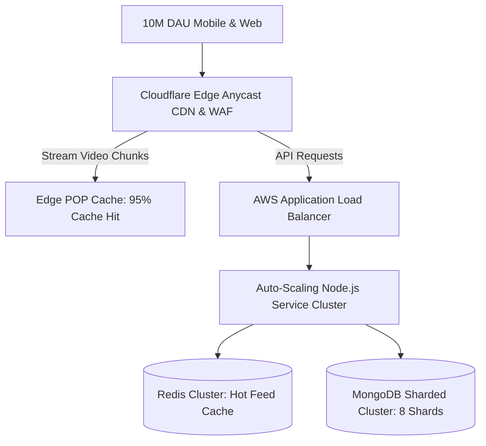
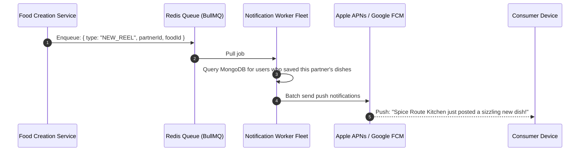
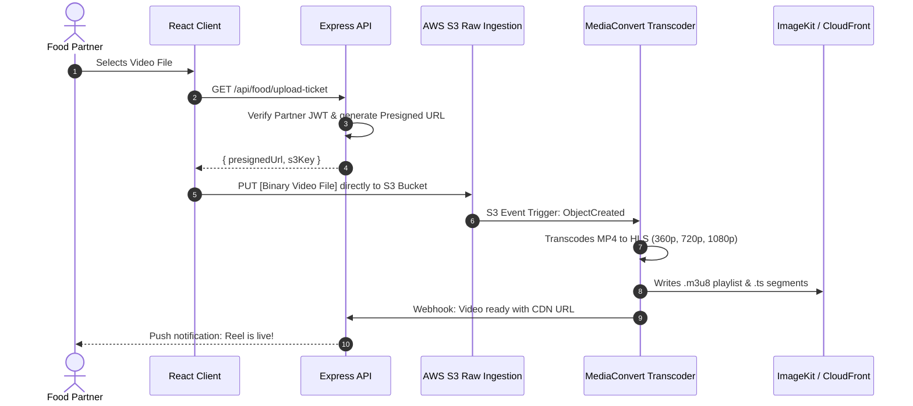

# 14.17 System Design: Classic Problems Applied to Zomato Reel Feed

This document provides full interview-style architectural solutions for classic system design questions, specifically adapted to reuse the building blocks (Express, MongoDB, Redis, ImageKit, JWT) of **Zomato Reel Feed**.

---

## Problem 1: Design the System at 100x Scale (10,000,000 DAU)

### 1. Requirements & Estimation
* **Scale:** $10,000,000$ DAU $\times 30$ reels/day = $300,000,000$ views/day.
* **QPS:** $\approx 3,500$ queries/second average; $10,000$ QPS peak.
* **Bandwidth:** $\approx 150 \text{ TB/day} \rightarrow \mathbf{14 \text{ Gbps}}$.

### 2. High-Level Architecture Diagram


### 3. Deep Dive & Bottlenecks
* **Primary Bottleneck:** Direct video egress from origin.
* **Solution:** Configure aggressive CDN edge caching headers (`Cache-Control: public, max-age=31536000, immutable`). 95% of video chunks are served from Cloudflare/ImageKit edge POPs, reducing origin requests from 10,000 QPS to 500 QPS.

---

## Problem 2: Design the Notification System

### 1. Requirements
* Notify consumers when a restaurant they bookmarked uploads a new culinary reel.
* Notify partners when their reel reaches 1,000 likes.

### 2. Architecture Diagram


---

## Problem 3: Design the File & Media Upload Pipeline

### 1. Requirements
* Support up to 200MB video uploads without crashing Node.js servers.
* Transcode uploaded MP4s into multi-bitrate HLS adaptive streams.

### 2. Architecture Diagram


---

## Problem 4: Design a Distributed Rate Limiter

### 1. Requirements
* Limit each IP to 10 login attempts per 15-minute window.
* Sub-millisecond latency; shared state across 10 Node.js API servers.

### 2. Architecture & Algorithm
* **Algorithm:** Sliding Window Counter in Redis.
* **Lua Script Atomicity:** To prevent race conditions, the check-and-increment executes inside a single atomic Redis Lua script:
  ```lua
  local key = KEYS[1]
  local now = tonumber(ARGV[1])
  local window = tonumber(ARGV[2])
  local limit = tonumber(ARGV[3])
  local clearBefore = now - window

  redis.call('ZREMRANGEBYSCORE', key, 0, clearBefore)
  local currentRequests = redis.call('ZCARD', key)

  if currentRequests < limit then
      redis.call('ZADD', key, now, now)
      redis.call('EXPIRE', key, window)
      return 1
  else
      return 0
  end
  ```

---

## Problem 5: Design a URL Shortener Using This Stack

### 1. Requirements
* Shorten a long restaurant reel URL (`https://zomato.com/food-partner/673f8a/dish/crispy-paneer`) into a 7-character code (`https://zmt.to/7xK9pQ`).

### 2. Implementation with Express & MongoDB
1. **Base62 Encoding:** Map an auto-incrementing integer ID or 64-bit counter using characters `[0-9a-zA-Z]`:
   $$62^7 \approx \mathbf{3.5 \text{ Trillion unique URLs}}$$
2. **Schema:**
   ```javascript
   const shortUrlSchema = new mongoose.Schema({
       shortCode: { type: String, unique: true, index: true },
       originalUrl: { type: String, required: true },
       clicks: { type: Number, default: 0 }
   });
   ```
3. **Redirection Route:**
   ```javascript
   router.get('/:shortCode', async (req, res) => {
       const record = await redis.get(`url:${req.params.shortCode}`) || 
                      await shortUrlModel.findOne({ shortCode: req.params.shortCode });
       if (!record) return res.status(404).send("Link expired");
       res.redirect(301, record.originalUrl);
   });
   ```

---

## Problem 6: Design a News Feed / Reel Feed Algorithm

### 1. Requirements
* Display the freshest, highest-engagement food reels to active users.

### 2. Feed Ranking Equation (Hacker News / TikTok Style)
$$\text{Score} = \frac{\text{Likes} \times 2 + \text{Saves} \times 5}{(\text{Age in Hours} + 2)^{1.5}}$$
* **Implementation:** The score is recomputed every 10 minutes via background aggregation and stored in a Redis Sorted Set (`ZSET`):
  ```javascript
  await redis.zadd("feed:ranked", score, foodId);
  // Fetch top 10 reels:
  const topReelIds = await redis.zrevrange("feed:ranked", 0, 9);
  ```
