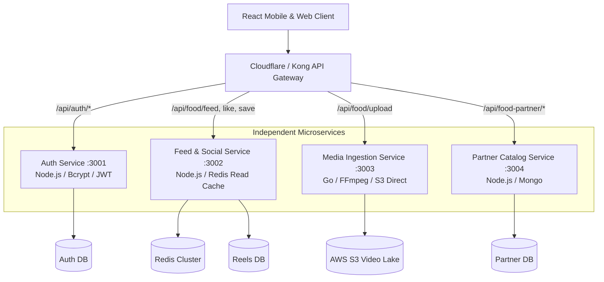

# 14.2 System Design: Architecture Styles & Decomposition

---

## 1. What It Is in Plain Words
Architecture style defines the structural organization of code and services: whether all features run as a single unified deployment unit (monolith), logically separated modules sharing one runtime (modular monolith), independent network services (microservices), or event-driven serverless functions.

---

## 2. Whether and How THIS Project Uses It
* **Current Architecture:** **Layered Modular Monolith (Client-Server / MVC Pattern)**.
  * The frontend is an independent Single Page Application in [`zomato/frontend`](file:///Users/avishjain/avishjain9-repos/55-zomato-reel-feed/zomato/frontend).
  * The backend is an Express 5 monolithic service in [`zomato/backend`](file:///Users/avishjain/avishjain9-repos/55-zomato-reel-feed/zomato/backend) structured as:
    * Routing Layer: [`routes/`](file:///Users/avishjain/avishjain9-repos/55-zomato-reel-feed/zomato/backend/src/routes)
    * Security & Policy Layer: [`middlewares/`](file:///Users/avishjain/avishjain9-repos/55-zomato-reel-feed/zomato/backend/src/middlewares)
    * Business & Controller Layer: [`controllers/`](file:///Users/avishjain/avishjain9-repos/55-zomato-reel-feed/zomato/backend/src/controllers)
    * Third-Party Integration Layer: [`services/`](file:///Users/avishjain/avishjain9-repos/55-zomato-reel-feed/zomato/backend/src/services)
    * Data Persistence Layer: [`models/`](file:///Users/avishjain/avishjain9-repos/55-zomato-reel-feed/zomato/backend/src/models)

---

## 3. Full Comparison: Architecture Styles

| Architecture Style | Deployment Complexity | Operational Overhead | Failure Isolation | Scalability Granularity | Developer Velocity (MVP) | Fit With Project |
|---|---|---|---|---|---|---|
| **Layered Monolith (Chosen)** | **Very Low (Single repo/container)** | **Minimal** | Low (Single crash affects all) | Coarse (Scale whole app) | **Maximum** | **10/10 (Optimal for current stage)** |
| **Microservices** | Very High (Kubernetes, gRPC, CI/CD) | Heavy (DevOps team required) | High (Fault isolation) | **Fine-Grained** | Very Low | 4/10 (Premature complexity) |
| **Serverless (AWS Lambda)** | Moderate | Low | High | Extreme (Auto-scaling) | Moderate | 6/10 (Cold starts destroy video upload) |
| **Event-Driven (CQRS/Kafka)**| High | Moderate to High | High | Very High | Low | 6/10 (Over-engineered for CRUD) |

### Why Monolith Was Chosen
* [CONFIRM WITH DEVELOPER]: A layered monolith provides rapid feedback, shared types and dependencies, zero network latency between modules, and atomic deployments. Introducing microservices prematurely adds distributed transaction headaches, network serialization latency, and deployment complexity with zero business benefit at this stage.

---

## 4. When and How This Project Would Be Split

When daily active users exceed 500,000, different components experience vastly different scaling profiles:
* **The Media Service** is memory- and network-heavy.
* **The Feed Service** is read-heavy ($8:1$ read:write ratio).
* **The Auth Service** is CPU-heavy (bcrypt hashing).

---

## 5. Trade-Offs Accepted
* In the monolith, if an unhandled error crashes the Node.js process during a video upload, all in-flight consumer feed requests fail simultaneously.

---

## 6. What Breaks at 10x, 100x, 1000x Load
* **10x:** Monolith handles load cleanly on a single $10/month cloud instance.
* **100x:** Video uploads cause memory spikes that starve event-loop cycles for feed viewers; requires separating the upload controller into a dedicated worker.
* **1000x:** Team organization bottlenecks emerge (multiple engineers colliding on the same repository); requires formal microservice team boundaries.

---

## 7. How a Senior Engineer Would Improve It
* Enforce **Hexagonal / Clean Architecture** interfaces: define strict repository interfaces for the database so MongoDB can be mocked or swapped without touching business controllers.

---

## 8. 30-Second Spoken Answer
> "I structured the backend as a layered modular monolith following the MVC pattern. It isolates routes, middlewares, controllers, and Mongoose models cleanly in code while deploying as a single lightweight container. 
> 
> I rejected a microservices architecture because microservices introduce distributed network latency, deployment overhead, and eventual consistency issues that slow down early iteration. When we scale to 500,000 DAU, our clean boundaries will allow us to extract the media upload service into a dedicated worker in days."
