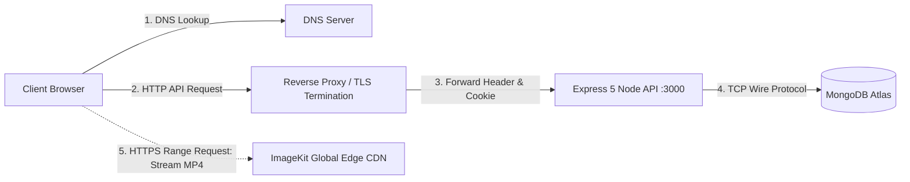

# 14.3 System Design: Networking & Communication Protocols

---

## 1. What It Is in Plain Words
Networking and communication architecture governs how data packets travel across the public Internet between mobile devices, edge caches, reverse proxies, and backend microservices, encompassing transport protocols (TCP vs UDP), application standards (HTTP/1.1, HTTP/2, HTTP/3), and communication paradigms (REST, WebSockets, gRPC).

---

## 2. Whether and How THIS Project Uses It
* **Current Request Path in Code:**
  1. **DNS Resolution:** Client queries local DNS for domain (e.g. `localhost`).
  2. **Client HTTP Engine:** Axios in [`Home.jsx:11`](file:///Users/avishjain/avishjain9-repos/55-zomato-reel-feed/zomato/frontend/src/pages/general/Home.jsx#L11) initiates HTTP/1.1 TCP handshake with port 3000.
  3. **CORS & Middleware Inspection:** Express processes `cors()` and `cookieParser()` on incoming TCP stream.
  4. **Media CDN Stream:** Video URLs point directly to ImageKit's global CDN (`https://ik.imagekit.io/...`), entirely bypassing the Express server for video data packets.

---

## 3. Protocol Comparisons

### HTTP/1.1 vs HTTP/2 vs HTTP/3

| Protocol | Transport Layer | Multiplexing | Head-of-Line Blocking | Header Compression | Performance on Lossy Mobile 4G/5G | Fit With Video Streaming |
|---|---|---|---|---|---|---|
| **HTTP/1.1 (Current)** | TCP | No (Pipelining flawed) | Severe (TCP & HTTP level) | None (Bloated cookies) | Poor | Adequate for single API hits |
| **HTTP/2 (Recommended API)** | TCP | **Yes (Single connection)** | Mitigated at HTTP level | **Yes (HPACK)** | Moderate (TCP loss stalls all streams) | Excellent for concurrent API calls |
| **HTTP/3 (QUIC) (CDN Default)** | **UDP (QUIC)** | **Yes** | **Zero (True stream isolation)** | **Yes (QPACK)** | **Outstanding** | **Optimal for mobile video chunk streaming** |

### API Communication Styles: REST vs GraphQL vs gRPC vs WebSockets

| Style | Protocol | Serialization | Schema Enforcement | Over-Fetching | Directionality | Fit With This Project |
|---|---|---|---|---|---|
| **REST (Chosen)** | HTTP/1.1 - 2 | JSON | Application level | Possible | Unidirectional (Req/Res) | **10/10 (Simple, universal, CDN cacheable)** |
| **GraphQL** | HTTP/1.1 - 2 | JSON | Strong (Schema / Typed) | Zero | Unidirectional (Queries) | 6/10 (Hard to cache at CDN layer) |
| **gRPC** | HTTP/2 | Protocol Buffers | Extreme (Protobuf IDL) | Zero | Bidirectional streaming | 8/10 (Ideal for internal microservices) |
| **WebSockets** | TCP (Upgraded) | Binary / Text | None (Custom) | N/A | Full-Duplex (Bidirectional) | 7/10 (Future real-time like/comment ticker) |

---

## 4. Why REST Was Chosen Over Alternatives
* [CONFIRM WITH DEVELOPER]: REST over JSON is the universal standard for client-to-backend web communication. Its standardized HTTP verbs (`GET`, `POST`) align perfectly with HTTP edge caching proxies, allowing CDNs to effortlessly cache video metadata responses while keeping client bundles lightweight without heavy GraphQL client libraries (like Apollo Client).

---

## 5. Trade-Offs Accepted
* REST endpoints can suffer from slight over-fetching (e.g. `GET /api/food-partner/:id` returns full contact information even if the client only needs the business name).

---

## 6. What Breaks at 10x, 100x, 1000x Load
* **10x:** HTTP/1.1 connection limits (browsers limit 6 TCP connections per domain) slow down parallel image/metadata fetching; resolved by enabling HTTP/2 on Nginx.
* **100x:** Node.js SSL/TLS handshake CPU consumption spikes; resolved by terminating TLS at Cloudflare or AWS ALB.
* **1000x:** High connection churn on TCP handshakes; requires HTTP/3 QUIC connection migration for mobile users switching between Wi-Fi and 5G.

---

## 7. How a Senior Engineer Would Improve It
* Place Cloudflare in front of the application to provide: (1) Automatic HTTP/3 termination, (2) Brotli payload compression, (3) DDoS mitigation, and (4) Global DNS resolution via Anycast network.

---

## 8. 30-Second Spoken Answer
> "Our application uses REST over HTTP/1.1 for standard client-server API requests and delegates high-bandwidth video delivery to ImageKit's edge CDN operating over HTTP/2 and HTTP/3 QUIC. 
> 
> I chose REST over GraphQL because REST endpoints map directly to HTTP cache headers (`Cache-Control`), enabling CDNs to cache public feeds without executing custom GraphQL resolvers on the server."
