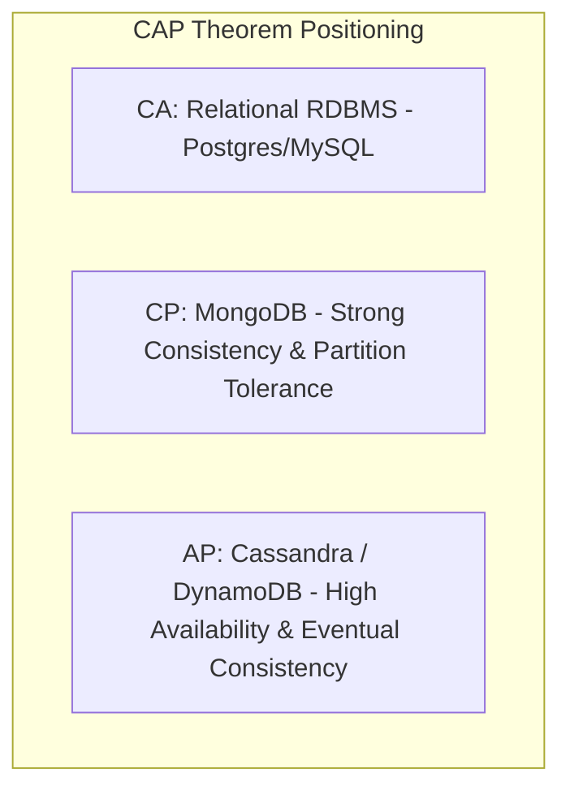
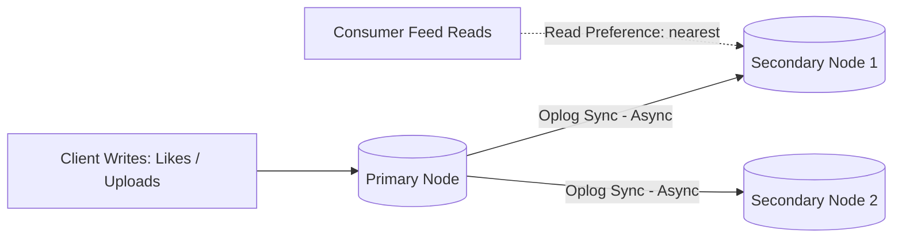

# 14.5 System Design: Databases & Storage Architecture

---

## 1. What It Is in Plain Words
Database and storage architecture establishes how application data is organized, persisted, indexed, replicated, and sharded across physical disk blocks and distributed clusters to balance consistency, durability, query latency, and write throughput.

---

## 2. Whether and How THIS Project Uses It
* **Primary Database:** MongoDB via Mongoose ODM ([`db.js`](file:///Users/avishjain/avishjain9-repos/55-zomato-reel-feed/zomato/backend/src/db/db.js)).
* **Cloud Media Storage:** ImageKit Cloud Object Storage ([`storage.service.js`](file:///Users/avishjain/avishjain9-repos/55-zomato-reel-feed/zomato/backend/src/services/storage.service.js)).
* **Data Modeling Paradigm:** Hybrid referencing with denormalized counters. We maintain relational reference collections (`likes`, `saves`, `foods.foodPartner`) while maintaining denormalized scalar integers (`likeCount`, `savesCount`) on the parent `Food` document.

---

## 3. Database Paradigms Comparison

| Paradigm | Exemplar Engine | Data Structure | Best Use Case | Where Project Data Fits |
|---|---|---|---|---|
| **Document (Chosen)** | **MongoDB** | **BSON Documents** | **Hierarchical content, rapid prototyping, JSON payloads** | **Primary fit for Users, Food Partners, and Video Reels** |
| **Relational (RDBMS)** | PostgreSQL | Structured Tables / Rows | Strict ACID financial transactions, deep relational joins | Order billing & payment ledger |
| **Key-Value** | Redis | In-memory key-hash | Sub-millisecond session & feed caching | Feed cache & rate-limit counters |
| **Wide-Column** | Cassandra | Sparse Multidimensional Map | High-write time-series telemetry (e.g. IoT metrics) | Poor fit for relational reels & likes |
| **Vector Database** | Atlas Vector Search | High-dimensional vectors | Semantic search & multimodal AI recommendations | Ideal for dish taste embedding indexing |

---

## 4. ACID vs BASE & CAP/PACELC Theorems

* **CAP Classification:** **CP (Consistency & Partition Tolerance)**. In a MongoDB replica set, writes route to the single Primary. During network partition, if a primary cannot reach a majority of nodes, it steps down to prevent split-brain writes, prioritizing Consistency over Availability.
* **PACELC Classification:** **PC/EC**. Under network partition (P), MongoDB chooses Consistency (C) over Availability (A); Else (E), it chooses Consistency (C) over Latency (L) when configured with majority write concerns.

---

## 5. Replication & High Availability Topology

* **Oplog Replication:** The Primary records all mutations in its `local.oplog.rs` collection. Secondaries tail the oplog asynchronously to replicate state.
* **Automated Failover:** If the Primary becomes unreachable, remaining secondaries hold an election using the Raft consensus algorithm and elect a new primary within 10–30 seconds.

---

## 6. Sharding Strategy (Scale to 100M Reels)
When the database exceeds 2TB or write throughput exceeds a single server's I/O capacity, we shard using **Hashed Sharding**:
* **Shard Key:** `{ _id: "hashed" }` for the `foods` collection.
* **Why Hashed?** Distributes new video uploads uniformly across all physical shard nodes, preventing "hot spotting" that occurs with monotonically increasing range keys (like auto-incrementing IDs or timestamps).

---

## 7. Storage Classification: Block vs File vs Object Storage
* **Block Storage (AWS EBS):** High-speed disk storage attached to virtual machines. Used to store MongoDB database data files.
* **File Storage (NFS / EFS):** Shared network filesystem. Too slow and expensive for database engines.
* **Object Storage (AWS S3 / ImageKit):** Flat, highly scalable storage accessed via HTTPS REST APIs. Ideal for immutable video binaries (`.mp4`), providing 99.999999999% (11 9's) durability at a fraction of the cost of block storage.

---

## 8. What Breaks at 10x, 100x, 1000x Load
* **10x:** Unindexed queries on `foodPartner` slow down profile rendering; fixed by adding single-field index.
* **100x:** Primary node write IOPS reach capacity; fixed by upgrading to NVMe SSD block storage.
* **1000x:** Storage exceeds single disk capacity; fixed by sharding the cluster across 8 shard replica sets.

---

## 9. 30-Second Spoken Answer
> "We use MongoDB as our primary document database because its BSON model mirrors our JSON API payloads and provides native atomic operators like `$inc` for video like counters. 
> 
> Under the CAP theorem, MongoDB acts as a CP system prioritizing strong consistency over availability during network partitions. In production, we deploy a 3-node replica set with automated Raft failover, pairing block storage for database indexes with ImageKit object storage for immutable video streams."
