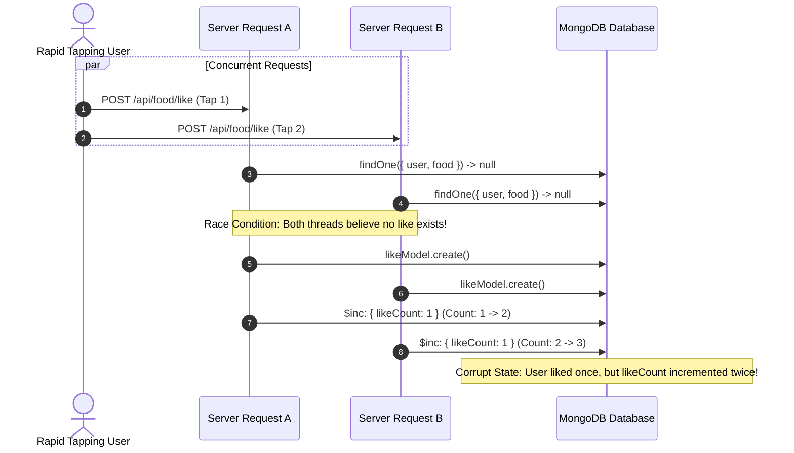

# 14.8 System Design: Consistency, Concurrency & Distributed Locking

---

## 1. What It Is in Plain Words
Concurrency and consistency engineering prevents data corruption, duplicate transactions, and race conditions when multiple users or background threads read and mutate the same shared database records simultaneously.

---

## 2. Whether and How THIS Project Uses It
* **Current Implementation:**
  1. **Atomic Operators:** In [`food.controller.js:50,64,91,105`](file:///Users/avishjain/avishjain9-repos/55-zomato-reel-feed/zomato/backend/src/controllers/food.controller.js#L50), `$inc: { likeCount: 1 }` and `$inc: { likeCount: -1 }` execute atomic counter updates directly inside MongoDB's WiredTiger storage engine, bypassing application-level Read-Modify-Write hazards.
* **Potential Race Condition in Current Code:**
  * In `likeFood` ([lines 38–41](file:///Users/avishjain/avishjain9-repos/55-zomato-reel-feed/zomato/backend/src/controllers/food.controller.js#L38-L41)), the query `likeModel.findOne({ user: user._id, food: foodId })` followed by `likeModel.create(...)` is vulnerable to a Time-of-Check to Time-of-Use (TOCTOU) race condition if the user taps the like button twice in rapid succession.

---

## 3. Concurrency Control Mechanisms Compared

| Concurrency Mechanism | Overhead | Deadlock Risk | Throughput Under High Contention | Implementation Complexity | Fit With This Project |
|---|---|---|---|---|---|
| **Atomic Database Operators (`$inc`) (Chosen)** | **Zero (Native DB Engine)** | **None** | **Ultra-High** | **Very Low** | **10/10 (Counters)** |
| **Optimistic Locking (Version `__v`)** | Low | Low (Requires retry logic) | Moderate (Fails on high contention) | Moderate | 8/10 (Dish metadata editing) |
| **Pessimistic Locking (Row/Document Locks)**| High (Holds exclusive locks) | High (Deadlock hazards) | Low (Blocks concurrent requests) | High | 4/10 (Too slow for social feeds) |
| **Distributed Locks (Redlock with Redis)** | Moderate | Low (TTL auto-release) | High | Moderate | 9/10 (Video transcoding & inventory) |

---

## 4. Race Condition Deep Dive: The Double-Like Hazard



### The Production Fix: Compound Unique Constraint
By declaring a compound unique index in Mongoose, the database engine enforces atomicity at the index level:
```javascript
likeSchema.index({ user: 1, food: 1 }, { unique: true });
```
When Thread 2 attempts to insert, MongoDB throws duplicate key error `E11000`, preventing the duplicate counter increment.

---

## 5. Consistency Models in Distributed Feeds
* **Strong Consistency:** Every read receives the most recent write. Mandatory for user authentication and password changes.
* **Eventual Consistency:** Reads may temporarily show stale data, but all replicas eventually converge. Acceptable for global reel like counters (e.g. if one user sees 1,420 likes and another sees 1,422 likes for a fraction of a second, business functionality is unaffected).
* **Read-Your-Own-Writes Consistency:** A user must immediately see their own likes and bookmarks reflected, achieved in our client by combining local optimistic state updates with cookie session tracking.

---

## 6. What Breaks at 10x, 100x, 1000x Load
* **10x:** Double-tapping users create duplicate records; resolved by adding compound unique indexes.
* **100x:** High write contention on viral video documents causes MongoDB WiredTiger cache eviction stalls; resolved by batching likes in Redis and flushing to MongoDB in 5-second intervals.
* **1000x:** Distributed network partitions between availability zones cause write delays; resolved by configuring multi-region leaderless eventual consistency (DynamoDB or Cassandra) for counter metrics.

---

## 7. 30-Second Spoken Answer
> "We maintain concurrency safety through MongoDB's atomic `$inc` operators, which execute directly within the database engine without application-level Read-Modify-Write hazards. 
> 
> To prevent race conditions during rapid double-tapping, we enforce a compound unique index on `{ user: 1, food: 1 }`. Under extreme scale, we adopt eventual consistency, buffering real-time likes in Redis HyperLogLogs before flushing batch increments to disk."
