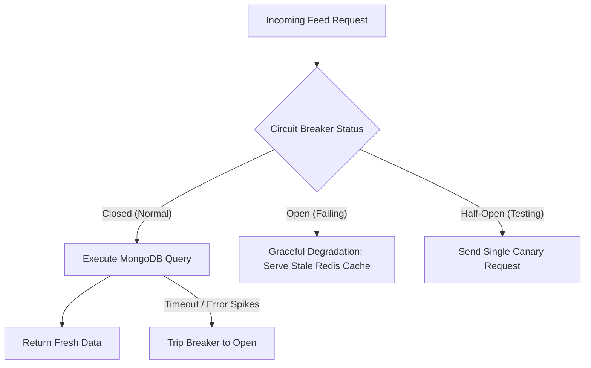

# 14.9 System Design: Reliability, Resilience & SLAs

---

## 1. What It Is in Plain Words
Resilience engineering ensures a system gracefully withstands, isolates, and recovers from infrastructure faults (cloud network partitions, slow databases, third-party CDN outages) without experiencing catastrophic cascading failure across the entire application.

---

## 2. Whether and How THIS Project Uses It
* **Current Implementation:**
  * **Autoplay Degradation:** In [`ReelFeed.jsx:20`](file:///Users/avishjain/avishjain9-repos/55-zomato-reel-feed/zomato/frontend/src/components/ReelFeed.jsx#L20), `video.play().catch(() => {})` gracefully swallows browser autoplay rejections, preventing unhandled runtime exceptions from crashing the UI.
* **Missing Resilience Patterns:**
  * Circuit breakers on ImageKit cloud API calls.
  * Timeout wrappers on Mongoose database queries.
  * Exponential backoff retry loops on network operations.

---

## 3. Availability Targets & The Meaning of Nines

$$\text{Availability} = \frac{\text{Uptime}}{\text{Uptime} + \text{Downtime}} \times 100$$

| Target Level | Meaning | Max Permissible Downtime / Year | Max Permissible Downtime / Month | Fit With Service Tier |
|---|---|---|---|---|
| **99% (Two Nines)** | Low Availability | 3.65 days | 7.31 hours | Internal test environments |
| **99.9% (Three Nines)** | **Standard Web SLA (Target)** | **8.77 hours** | **43.8 minutes** | **Consumer video feed & browsing** |
| **99.99% (Four Nines)** | High Availability | 52.6 minutes | 4.38 minutes | Payment gateways & merchant checkout |
| **99.999% (Five Nines)** | Carrier Grade | 5.26 minutes | 26.3 seconds | Telephony, hospital emergency systems |

### SLI vs SLO vs SLA
* **Service Level Indicator (SLI):** Quantifiable real-time metric (e.g. *"Feed API latency measured at p95 is 140ms"*).
* **Service Level Objective (SLO):** Internal engineering target (e.g. *"99.5% of feed requests must complete within 250ms over any rolling 30-day window"*).
* **Service Level Agreement (SLA):** External commercial commitment with customers with financial penalties for breach (e.g. *"99.9% uptime or 10% credit refund"*).

---

## 4. Resilience Patterns Architecture

### The Circuit Breaker Pattern (Opossum SDK)
If ImageKit or MongoDB begins timing out, the circuit breaker trips from `CLOSED` to `OPEN`, immediately serving cached responses or friendly degradation screens without wasting thread sockets on doomed connection attempts.

---

## 5. Disaster Recovery Metrics: RTO vs RPO
* **Recovery Time Objective (RTO):** The maximum acceptable duration of time the system can remain offline following a disaster (e.g. **Target: RTO < 15 minutes** using automated container failover).
* **Recovery Point Objective (RPO):** The maximum acceptable age of data that can be permanently lost during a disaster (e.g. **Target: RPO < 60 seconds** via MongoDB continuous oplog point-in-time backups).

---

## 6. What Breaks at 10x, 100x, 1000x Load
* **10x:** ImageKit temporary rate limit causes upload errors; resolved by adding exponential backoff retries.
* **100x:** Database connection pool exhaustion freezes the entire API; resolved by implementing Bulkhead pattern (isolating feed read pools from video upload pools).
* **1000x:** Full cloud region outage; resolved by establishing multi-region warm standby replica clusters.

---

## 7. 30-Second Spoken Answer
> "We design for failure using the Circuit Breaker and Bulkhead patterns to prevent cascading outages. If our database encounters transient latency, the circuit breaker opens and gracefully degrades by serving stale cached reels from Redis rather than dropping user connections. 
> 
> Our production target is 99.9% availability, backed by an RTO under 15 minutes and point-in-time MongoDB backups achieving an RPO under 60 seconds."
