# System Design Deep Dive: Zomato Reel Feed

This module provides exhaustive system design breakdowns for the **Zomato Reel Feed** platform, addressing every distributed systems concept, capacity estimation, scaling bottleneck, and architectural trade-off that senior engineering interviewers probe.

---

## System Design Syllabus

```mermaid
flowchart TD
    SD[System Design Deep Dive]
    SD --> S1[14.1 Requirements & Capacity Estimation]
    SD --> S2[14.2 Architecture Styles & Monolith vs Microservices]
    SD --> S3[14.3 Networking & Communication Protocols]
    SD --> S4[14.4 Load Balancing & Autoscaling Strategy]
    SD --> S5[14.5 Databases & Storage Architecture]
    SD --> S6[14.6 Caching Layers & Cache Stampede Defense]
    SD --> S7[14.7 Messaging, Queues & Async Processing]
    SD --> S8[14.8 Consistency, Concurrency & Locking]
    SD --> S9[14.9 Reliability, Resilience & SLAs]
    SD --> S10[14.10 API Gateway & Rate Limiting Algorithms]
    SD --> S11[14.11 Security Architecture & Token Revocation]
    SD --> S12[14.12 Search & AI Recommendation Systems]
    SD --> S13[14.13 Real-Time Protocols & WebSockets]
    SD --> S14[14.14 Observability, Tracing & Logging]
    SD --> S15[14.15 Performance Engineering & Profiling]
    SD --> S16[14.16 Cloud Cost Economics & Trade-offs]
    SD --> S17[14.17 Classic System Design Problems Applied]
    SD --> S18[14.18 Master Design Decisions Audit Log]
```

---

## Topic Index

| Topic File | Core Theme | Key Systems Discussed |
|---|---|---|
| [**14.1 Requirements & Estimation**](./14.1-requirements-estimation.md) | Math & Capacities | Daily Active Users, QPS, Read:Write Ratio, Storage Growth, Bandwidth. |
| [**14.2 Architecture Styles**](./14.2-architecture-styles.md) | Topology | Monolith vs Modular Monolith vs Microservices vs Serverless. |
| [**14.3 Networking & Protocols**](./14.3-networking-communication.md) | Transport | DNS, CDN Edge, Reverse Proxy, HTTP/1.1 vs HTTP/2 vs HTTP/3, TLS. |
| [**14.4 Load Balancing & Scaling**](./14.4-load-balancing-scaling.md) | Scalability | L4 vs L7 Balancing, Round Robin, Least Connections, Single Points of Failure. |
| [**14.5 Databases & Storage**](./14.5-databases-storage.md) | Persistence | MongoDB vs Postgres, B-tree indexes, Sharding, Replication, CAP & PACELC. |
| [**14.6 Caching Strategies**](./14.6-caching.md) | Latency Reduction | Browser byte-range, CDN edge, Redis Cache-Aside, Cache Stampede. |
| [**14.7 Messaging & Queues**](./14.7-messaging-queues.md) | Async Workflows | BullMQ, RabbitMQ, Kafka, Video Transcoding Pipeline, Dead Letter Queues. |
| [**14.8 Consistency & Concurrency**](./14.8-consistency-concurrency.md) | Data Integrity | Atomic `$inc`, Optimistic vs Pessimistic Locking, Race Conditions. |
| [**14.9 Reliability & Resilience**](./14.9-reliability-resilience.md) | High Availability | Circuit Breakers, Exponential Backoff, 99.99% SLAs, Graceful Degradation. |
| [**14.10 API Gateway & Rate Limiting**](./14.10-api-design-rate-limiting.md) | Traffic Control | Token Bucket, Sliding Window Log, Cursor Pagination, Idempotency Keys. |
| [**14.11 Security Architecture**](./14.11-security-architecture.md) | Defense in Depth | Zero Trust, JWT Cookie Security, OWASP Top 10, Data Encryption. |
| [**14.12 Search & AI Architecture**](./14.12-search-ai-architecture.md) | Discovery | Gemini 1.5 Flash Vision, Atlas Vector Search, Cosine Similarity. |
| [**14.13 Real-Time Systems**](./14.13-real-time-systems.md) | Live Events | WebSockets vs SSE vs Long Polling, Redis Pub/Sub, Live Like Counters. |
| [**14.14 Observability & Operations**](./14.14-observability-operations.md) | Monitoring | Structured Logging (Pino), Prometheus Metrics, Sentry Error Tracking. |
| [**14.15 Performance Engineering**](./14.15-performance-engineering.md) | Optimization | Latency Percentiles (p99), Little's Law, Mobile 60fps Profiling. |
| [**14.16 Cost Economics**](./14.16-cost-tradeoffs.md) | Cloud Spend | Current Monthly Cost ($0) vs 100x Scale Projection ($350/mo). |
| [**14.17 Classic System Design Problems**](./14.17-classic-system-design-problems.md) | Interview Problems | URL Shortener, Notification Engine, News Feed, Upload Pipeline. |
| [**14.18 Master Decisions Log**](./decisions.md) | Decision Trace | Table of every architectural decision, alternative, and revisit trigger. |
